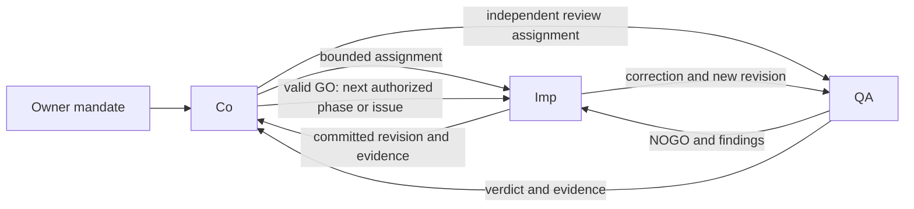

<!-- pgmcp:v1 id=generic_doc pv=1.0.0 pf=WfqMtGpITDXzqFVQ sf=WI5iXHBKVOU91bYE -->

# Issue 1 research notes: coordinator-led autonomous collaboration

**Status:** RESEARCH NOTES — worktree constraints approved; remaining operating policy proposed  
**Version:** 1.2  
**Last Updated:** 2026-10-21

## Purpose

Test the manual-handover hypothesis against current PGMCP sources, all exposed PGMCP skills, actual Codex tool contracts and official OpenAI documentation.

## Scope In

Current role protocols, nine skill entrypoints and their five shared procedures, phase instructions, deployment/consumer consistency, Codex orchestration capabilities, independent review policy and sustained-session requirements.

## Scope Out

Application implementation, installing a future application's stack, server implementation, blanket publication/merge permission, live orchestration exercises or changing role authority during this research.

## Summary

The current model preserves separate role contexts and bounded delegation, but explicitly routes key review/correction transitions through the human. A coordinator-led autonomous model requires changes to authority, continuation and lifecycle policy as well as explicit tool-mediated interaction. This note records evidence and proposals; it does not activate a new execution mandate or claim a tested autonomous product workflow.

## Owner intent

The owner wants a short instruction to Co to drive multiple issues from a loosely specified idea to a working product, with Imp doing production work and QA independently enforcing phase boundaries through explicit GO/NOGO. Workspace-local application/tool installation and autonomous continuation are desired. This is the target policy to design; it is not evidence that current protocols already implement it. Product completion criteria, authority for external effects, integration/merge scope, resource limits and the operational permission profile still need explicit treatment in that reusable mandate.

## Owner-approved worktree constraints

The owner explicitly decided that every worktree must have its own PGMCP server instance to prevent context mixing, and that at most one mutating Imp agent may be active within a worktree at any time. These are binding design/execution constraints; provisioning has not yet been performed in this research.

- One dedicated server instance serves one worktree. Bind its workspace root, server-data root and mutable workflow state, caches/logs/locks to that worktree. Co, Imp and QA accessing that worktree use its correctly identified instance; no instance may silently serve another worktree.
- At most one Imp with mutation authority is active per worktree. Installation, configuration, production/test/doc edits and Git/PGMCP mutations count toward that assignment. Imp descendants or implementation workers do not create additional concurrent mutation slots.
- Co owns assignment and release of that mutation authority and delegates installation to Imp. Before reassignment after interruption, verify the earlier worker and any in-flight mutation have stopped; absence of recent output is not proof of termination.
- Read-only investigation/review can be concurrent where its evidence remains stable. A QA verdict still targets an exact revision; implementation cannot change the reviewed surface during a same-worktree review.
- Different worktrees may each run their own mutating Imp concurrently. Shared integration operations remain coordinated by Co.
- Before work, verify the tuple worktree, branch, issue and server instance. On mismatch or unknown mutation ownership, stop that worktree's mutations and reconcile through Co.

## Current model: decisive evidence

| Finding | Source | Consequence |
| --- | --- | --- |
| Independent QA requires a separate human-invoked chat in all three role skill entrypoints. | [Co skill](../../../.agents/skills/pgmcp-co/SKILL.md), [Imp skill](../../../.agents/skills/pgmcp-imp/SKILL.md), [QA skill](../../../.agents/skills/pgmcp-qa/SKILL.md), all around lines 9–12. | Co cannot obtain the desired autonomous independent verdict simply by delegating a producer preflight. |
| Imp ends by asking the user to start separate independent QA; QA routes correction continuation back through the user. | [Imp role](../../../.pgmcp/agents/roles/imp.md), Two-chat model; [QA role](../../../.pgmcp/agents/roles/qa.md), Two-chat model. | The human is an explicit routing dependency. |
| Bounded delegation already exists, but producer-delegated review is findings-only. | [General protocol](../../../.pgmcp/agents/agents.md), Delegation and Review Authority. | The current model is partly delegation-aware; the problem is missing coordinator-owned review/continuation authority and interaction contracts. |
| Ordinary go execution is locked to the active phase; start-issue stops after initializing a non-epic branch; end-issue only recommends the next issue. | [Go](../../../.pgmcp/agents/workflows/go.md), [start-issue](../../../.pgmcp/agents/workflows/start-issue.md), [end-issue](../../../.pgmcp/agents/workflows/end-issue.md). | Autonomous work across phase and issue boundaries needs an explicit continuation mode. |
| Research requires human Approved Strategy; issue creation and lifecycle exit contain human confirmation/invocation gates. | [General protocol](../../../.pgmcp/agents/agents.md), [create-issue](../../../.pgmcp/agents/workflows/create-issue.md), [end-issue](../../../.pgmcp/agents/workflows/end-issue.md). | A reusable mandate must delegate specific decision classes instead of repeatedly requesting routine approval. |
| Phase behavior is also runtime configuration, not only role prose. | [Workflow contracts](../../../.pgmcp/config/defaults/contracts.yaml), [enforcement](../../../.pgmcp/config/defaults/enforcement.yaml). | Updating only role Markdown or skills would leave contradictory phase stops. The inspected enforcement config has no distinct independent-QA-verdict validation action; stronger server enforcement is outside this docs issue. |

## Complete exposed PGMCP skill inventory

| Skills | Current responsibility | Required reconciliation |
| --- | --- | --- |
| pgmcp-co / pgmcp-imp / pgmcp-qa | Three separate role entrypoints, shared protocols and producer-versus-independent review distinction. | Establish coordinator-authorized QA, role-stable receiving/return paths and references to one policy. |
| pgmcp-start | Role selection and current state/rule synchronization. | Accept a mandate/assignment context without changing roles mid-session. |
| pgmcp-go | Execute or discuss one active phase, optional adjust/discuss modes. | Continue automatically to the next authorized assignment after the required verdict; preserve interactive single-phase operation as a supported mode. |
| pgmcp-create-issue | Gather issue fields, scaffold, show concrete body and publish after confirmation. | Allow classification and publication inside explicit owner-delegated issue authority. Preserve missing-mandate escalation. |
| pgmcp-start-issue | Co owns real branch creation, checkout, initialization and plan verification; hands initialized child branch to Imp. | Deliver assignment directly and verify recipient workspace/state before work. |
| pgmcp-end-issue | Explicitly authorized merge, parent update, reachability and cleanup; advisory next issue. | Continue the next authorized issue after proven closeout, with merge/closure authority supplied by the original scoped mandate. |

All nine entrypoints and all five underlying procedures were read. Skills are invocation surfaces, not nine independent operating policies.

## Codex mechanisms actually available here

| Need | Available mechanism / evidence | Boundary |
| --- | --- | --- |
| Persistent role chats | create_thread; read_thread; send_message_to_thread; wait_threads in the app tool contracts. | New chats and inter-chat messaging require direct human authorization under the current tool contracts. An agent's request to reply does not itself authorize return messaging. A reusable human mandate must explicitly cover creation and both message directions, with verifiable provenance. |
| Bounded workers | collaboration.spawn_agent, send_message, followup_task, wait_agent, interrupt_agent and list_agents; pgmcp custom roles are exposed. | Use for current-task subwork. Do not create sidebar chats for every subtask. Invocation and authority must match the role; producer review remains findings-only. |
| Focused context | Fresh-context role invocation and bounded task briefs, with issue/branch/SHA/phase/artifact references. | A fresh QA context verifies source evidence rather than inheriting a producer's conclusion. Separate context provides procedural independence, not guaranteed objective judgment. |
| Workspace isolation | Managed Git worktree tools and host worktree support. | Worktrees isolate repository checkouts, but ignored environment/server assets and the actual MCP binding must also target the correct checkout. |
| Sustained work | Parent orchestration loop, durable status/decision artifacts and goal-style continuation. | Runtime permissions, capacity, availability and approvals still apply; a prompt does not grant broader access or guarantee uninterrupted operation. |

Parallel issue work is a valid target within one logical project/workspace when each issue has its own Git worktree and branch. Worktrees isolate checked-out files and the current branch while sharing repository history. Each PGMCP execution context must bind to the intended worktree and its branch-local state/configuration. A separate worktree-bound PGMCP server instance is mandatory for every worktree under the owner-approved constraints above; a shared fixed-root connection does not route automatically based on another chat's current directory. The current local MCP registration is fixed-root, so correct worktree provisioning still needs demonstration. Serialize mutations within the same checkout and shared integration actions, rather than serializing all work across different worktrees. Do not publish machine-specific launcher paths.

The three local .codex/agents/pgmcp-*.toml consumers still contain the stale assertion that quality tools are intentionally unconfigured. Their relative portable skill entrypoints now reference the updated quality policy, so deployment drift already exists. Those local consumers need reconciliation, not publication of machine-specific copies.

Official OpenAI documentation states that subagents inherit parent sandbox/approval settings and custom agent files cannot replace those settings. Read-only QA instructions therefore do not create a separate OS-enforced read-only sandbox. Document process authority and actual technical restrictions separately.

## Proposed operating model

This is a proposal, not newly activated policy.

| Role | Owns | Cannot substitute for |
| --- | --- | --- |
| Co | Owner mandate, interpretation of the idea, explicit assumptions, issue graph, assignment routing, scheduling, status and authorized lifecycle coordination. Delegates installation and environment provisioning to Imp. | QA's independent verdict, Imp's implementation evidence or hands-on installation/build work. |
| Imp | Research/design/planning/production work on its assigned initialized issue branch, local environment setup, meaningful tests, repairs, evidence and reproducibility. | Its own independent approval. |
| QA | Independent review of each required phase boundary against the owner mandate, authoritative phase contract and exact reviewed revision; explicit GO/NOGO with reasons. | Product-owner decisions outside the delegated envelope or production repairs. |

Co appoints the QA authority under the owner's explicit mandate. Independence depends on separate role context, no authorship of the reviewed work, unchanged acceptance criteria, direct evidence and unfiltered verdict reporting; it does not require the human to launch every review. For Co-produced epic documentation, QA still reviews independently of that producer. Imp-delegated preflight stays findings-only. Neither Co nor Imp may rewrite a NOGO into a GO or change scope merely to obtain approval.

A verdict identifies mandate, assignment, issue, branch, reviewed commit SHA, phase/cycle, applicable contract, evidence, findings and GO/NOGO. It expires for affected work when the revision or governing requirements change. Co schedules the next phase only after the matching valid GO and explicit scope checks. The role owning the branch performs its permitted PGMCP mutation; Co permits parallel execution in separate verified worktrees and serializes mutations within each checkout plus shared integration operations. A QA review on an Imp worktree requires the reviewed revision to remain stable; alternatively QA can inspect a separate checkout of the exact committed revision.

Persistent chats are useful for the continuing Co/Imp/QA responsibilities. Bounded subagents are useful for research questions, sequential implementation slices, implementation in separate worktrees, and review support. Every mutating implementation worker counts toward the single active mutating Imp limit in its worktree, including descendants; separate file ownership within one worktree does not permit a second mutating Imp. A Co-owned sibling QA role can be the designated independent authority if the revised mandate/protocol explicitly grants that authority. A subagent spawned by Imp as preflight does not gain that authority merely by being called QA.

## Mandate for a vague idea to a working product

A short future prompt can refer to a reusable autonomous-product mandate. That mandate should delegate:

1. Discovery and product interpretation: Co turns the vague idea into explicit assumptions, target users, intended outcomes, non-goals and measurable completion criteria. Agents can choose within the delegated envelope, retain rationale and revise assumptions from evidence. They must not silently claim that inferred preferences were explicitly stated by the owner.
2. Decision authority: specify whether Co may select application technology, approve strategy within boundaries, classify/create issues and choose implementation order. This replaces recurring routine owner gates with delegated decisions and independent QA checks.
3. Workspace execution: Co delegates installation and environment provisioning to Imp. Imp installs necessary application dependencies and development tools into workspace-local environments and runs local services, builds, migrations on synthetic/local data, meaningful tests and demonstrations. Imp records pins and reproduction steps; Co tracks prerequisites and results. Separate mutable dependencies, generated output, service ports and local databases for concurrent worktrees, or explicitly coordinate a shared resource. Installing application software in this future mandate does not authorize altering the host globally.
4. Integration authority: name allowed repository/branches and whether Co may push, create PRs, merge and close issues after matching QA GO. These are separate from local installation permission. Issue 1 can define scoped authority without granting blanket publication or merge rights.
5. Autonomy and recovery: use message-based assignments and return paths, durable checkpoint/status records, explicit file ownership, one dedicated PGMCP server instance and at most one active mutating Imp per worktree, bounded retries and progress-based replanning. Resume by reading actual current state and the last valid verdict; do not trust stale chat memory after interruption or compaction.
6. Completion and limits: product acceptance requires a clean reproducible setup, a running application, representative end-to-end journeys, configured relevant quality checks and explicit QA acceptance at the product boundary. Specify a practical resource/retry envelope and how to report an unrecoverable or externally blocked task. No unconditional promise that every vague idea is solvable without any outside input is supportable.

Suggested default interpretation of working product is a locally startable, tested product in the workspace. Public deployment, spending, third-party account setup and outward communications require explicitly named authority rather than being inferred from the installation clause. Owner-approved assumptions and budgets can be reusable profile defaults so each new prompt stays short.

## Documentation and deployment blast radius

The coherent change surface comprises the general protocol, all three role sources, all nine skill entrypoints, the five procedures, affected workflow phase instructions/hand-over contracts, the workspace AGENTS/README references, and the Codex capability/deployment mapping. Preserve one generic policy and a separate host mechanism mapping. Keep a versioned public-safe distribution of reviewed source changes and an explicit source-to-effective-.pgmcp-to-skill/.codex reconciliation process; both .pgmcp and .codex operational trees are currently ignored except branch-local lifecycle facts. Do not leave the intended change only in ignored local files or modify installed package assets. Any runtime config delta belongs in reviewed workspace overrides, not silent edits to packaged defaults.

## Required review exercises and present evidence limits

Later document review must exercise normal assignment/review, QA NOGO/correction/new revision, an owner decision outside the mandate, interruption/compaction and resumption, unavailable chat/subagent/worktree capability, stale verdict rejection and concurrent mutation prevention. Current evidence is source/tool-contract inspection and official documentation, not live role-to-role execution. No extra chats, subagents, product packages or application files were created as part of this research. Runtime enforcement of a persisted independent verdict, if required beyond procedural control, may need a separate harness/server issue.

## Related Documents

- [Issue 1](<https://github.com/MikeyVK/MyBrain/issues/1>)
- [Repository agreements](<../../../README.md#working-agreements>)
- [Official subagents documentation](<https://learn.chatgpt.com/docs/agent-configuration/subagents>)
- [Official Git worktrees documentation](<https://learn.chatgpt.com/docs/environments/git-worktrees>)
- [Official long-running work documentation](<https://learn.chatgpt.com/docs/long-running-work>)
- [Official approvals documentation](<https://learn.chatgpt.com/docs/agent-approvals-security>)

## Version History

| Version | Date | Author | Changes |
| --- | --- | --- | --- |
| 1.0 | 2026-10-21 | @imp planner | Record current three-agent evidence, skill inventory, Codex capability boundaries and proposed autonomous mandate. |
| 1.1 | 2026-10-21 | @imp planner | Apply owner clarification: Co delegates installation to Imp; parallel worktrees are supported design intent with correctly bound PGMCP contexts. |
| 1.2 | 2026-10-21 | @imp planner | Record owner-approved dedicated server per worktree and single active mutating Imp per worktree, including delegated implementation workers. |
