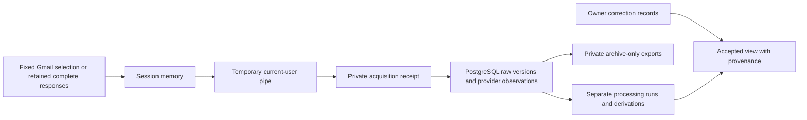

<!-- pgmcp:v1 id=design pv=1.0.0 pf=Uk1D2XWpiag1c6nn sf=WI5iXHBKVOU91bYE -->

# Design: bounded private raw-email storage trial

**Status:** DRAFT — independent Design review requested  
**Version:** 1.0  
**Last Updated:** 2026-10-22

## Purpose

Define the smallest operator-driven PostgreSQL trial that can preserve the fixed eight-message sample and prove archive recovery. This is a trial contract, not a production ingestion service.

## Scope In

The approved three conversations/eight messages, existing private database, complete original bytes and separate provider snapshots/derivations, repeat import, correction protection, visible failures and offline archive retrieval.

## Scope Out

Reusable application platform, UI, unattended imports, account discovery, external AI, production migration, database recreation, PGMCP/quality-policy changes, PR/merge/closure.

## Problem Statement

A private PostgreSQL database exists but contains no application tables or messages. The trial must turn the exact selected connector responses into a durable, self-managed archive while making no unsupported completeness, semantics or application-test claims.

## Functional Requirements

- Preserve all selected raw mail bytes, complete headers and MIME content; preserve required supplementary originals separately when genuinely absent from raw.
- Keep provider observations, source versions, processor runs, extracted text, reply relationships, proposed context and accepted corrections distinguishable and traceable.
- Repeat identical import without additional source/version records; resume interrupted processing and retrieve every archived message without Gmail acquisition.

## Nonfunctional Requirements

- Private data stays in memory or the approved private runtime outside the repository; no private payloads or identifiers in process arguments, console output, repository/workflow artifacts or public evidence.
- Use existing PostgreSQL 18.6, psql, PowerShell/.NET, host Node runtime and Python standard library; no additional service, database driver package or external provider.
- Keep source recovery independent of parser success and derivation quality; report counts, checks and failures honestly. Application-test bindings remain deferred.

## Constraints

- The private manifest is the authoritative fixed selection. The declared three-thread count is verified against provider observations, never used to discover replacement messages.
- Only the dedicated instance may start; existing database identity, loopback binding and private access controls must match before writes. No initdb, createdb, replacement or other service change.
- Design introduces no production code or schema. Implementation may use transient bounded operator commands after Planning approval. Any persistent reusable runner/source module requires explicit artifact/check admission; it must not be hidden in documentation or ignored runtime directories.

## Options

### 1. PostgreSQL bytea with operator-controlled import — selected

Store raw message bytes and any required supplementary original bytes in the existing private database, with separate relational identities and JSONB projections. Existing native SQL and standard-library operator commands perform this fixed-sample experiment.

**Pros:**

- One transactional preservation boundary for this small sample; no external file/catalogue consistency protocol or new database driver.
- No application service or reusable framework needed to establish the requested evidence.

**Cons:**

- Binary content increases database size; no conclusion about future large-media storage.
- Operator procedures must keep private SQL input, export paths and errors out of console/argv.

### 2. Immutable files with a PostgreSQL catalogue

Valid future route, but not selected for this eight-message trial.

**Pros:**

- Natural fit for large binary sources.

**Cons:**

- Adds durable file/catalogue coordination, missing-file and orphan recovery without improving the current sample's proof.

### 3. Reusable ingestion application or reconstructed text-only archive

Not selected: a service adds scope and code admission; text-only reconstruction violates full-source preservation.

**Cons:**

- Neither is needed for the bounded operator trial.

## Decision

Use PostgreSQL bytea as the authoritative raw archive. Separate append-only source versions, provider observations, processor outputs and correction records. Use a temporary current-user-only local pipe only to transfer existing connector values into a private operator receipt; no mailbox search or HTTP listener.

## Rationale

This applies Research's additive, privacy-preserving strategy without migrating a consumer or selecting the final application stack. Existing native tools suffice for a one-off trial; declared contracts and aggregate evidence make its limited claims reviewable.

## Production Design

### Execution boundary

The implementation is an operator-driven storage experiment, not a shipped application. Transient host commands may use Python's standard-library byte/MIME/JSON/hash functions and native psql. SQL is supplied to the child process over its programmatic input stream, not command-line arguments; private exports go to the approved private directory rather than stdout. Captured failures stay private and only stable error codes/counts reach the console. SQL values require validated, non-interpolated data transport or rigorously encoded byte/text literals; source-derived identifiers must never become SQL identifiers.

PostgreSQL source bytes and supplementary originals are authoritative. Private acquisition receipts preserve full connector results as received and survive interruption before database commit; decoded/reformatted exports are verification copies, not replacements. Public records contain contracts, aggregate outcomes and screened documentation only. No reusable application source or extra dependencies are selected; this does not authorize bypassing code admission if implementation expands into a persistent runner.

### Host feasibility evidence

A synthetic non-TTY exec probe using Python `sys.stdin.readline()` immediately returned zero characters; a later tool call cannot be assumed to feed that closed input. A synthetic PowerShell `NamedPipeServerStream(CurrentUserOnly)` plus host Node `node:net` client delivered nine characters, with receiver count nine, exit 0 and pipe disposed. No mail, file or database data was used. The probe compared a synthetic character count only. It proves a small local IPC boundary, not byte-for-byte real-mail transport, large-payload transfer, persistence or Gmail completeness. Real transfer still needs framed-length/digest/selection checks and host-approved private writes.

The existing Windows pg_ctl wrapper must redirect control output to a private log, not inherited PIPE handles; the earlier administrative check established that PIPE capture can hang after server start.

## Test Design

There is no existing application test suite to adapt. Keep configured app checks/tests inactive; do not relabel operator observations as native passing tests. Where a phase requires `run_tests(scope="configured")`, call it and report its real neutral/inactive outcome. Public Markdown/configuration checks continue through PGMCP.

Bounded operator verification exercises externally observable archive behavior, not implementation-private helpers. A private synthetic verification namespace/correction with explicit test provenance provides meaningful negative cases without falsifying accepted facts in the real sample. Corrupt/truncated frames, mismatched selection, missing MIME content, conflicting bytes, interrupted processing and changed proposals must be rejected or visibly classified while preserving valid archived bytes. Test records are separately counted and excluded from the three/eight source totals. No patient/customer examples enter public fixtures.

## Contracts

### Typed preservation records

These are declarative trial records, not executable implementation or final product schema. UUIDs, provider values, digests, filenames, content and diagnostics below are private operational values.

| Record | Typed fields and constraints |
| --- | --- |
| Source | `id: uuid`, `provider_scope: text`, `provider_message_id: text`; unique(scope, message_id). Scope is one stable local selection/account binding; no cross-account/global-ID assumption. |
| SourceVersion | `id: uuid`, `source_id: uuid FK`, `raw_bytes: bytea`, `sha256: bytea[32]`, `byte_count: bigint > 0`, `acquired_at: timestamptz`, `fidelity: received/unverified/verified/conflict`; unique(source_id, sha256), length/hash match bytes. Candidate bytes are never overwritten. |
| ProviderObservation | `id: uuid`, `source_version_id: uuid FK`, `observed_at: timestamptz`, `raw_response_utf8: bytea`, `full_response_utf8: bytea?`, `metadata: jsonb`; original connector envelopes retained separately from queryable projections. Includes provider thread and available label/history/date/size observations. |
| Supplement | `id: uuid`, `source_version_id: uuid FK`, `provider_part_ref: text`, `original_bytes: bytea`, `sha256: bytea[32]`, `byte_count: bigint`, `reason: text`; unique(version, part_ref, digest), exact original only, not extracted preview. |
| ProcessingRun | `id: uuid`, `source_version_id: uuid? FK`, `source_id: uuid FK`, `operation: text`, `processor: text`, `processor_version: text`, `configuration_digest: bytea[32]`, `started_at/finished_at: timestamptz?`, `status: pending/running/succeeded/failed/incomplete/interrupted/unsupported`, `error_code: text?`, `private_details: jsonb`. Acquisition can fail before a version exists. |
| Derivation | `id: uuid`, `source_version_id: uuid FK`, `run_id: uuid FK`, `kind: text`, `value: jsonb`, `value_digest: bytea[32]`; kinds include MIME inventory, text, reply relation and proposed context. Exact repeated output may be reused; changed processor/config/output remains separately traceable. |
| Correction | `id: uuid`, `source_version_id: uuid FK`, `derivation_id: uuid? FK`, `value: jsonb`, `actor: text`, `accepted_at: timestamptz?`, `supersedes_id: uuid? FK`, `provenance: owner/test`; processor has no correction-update/delete operation. Test provenance never implies owner acceptance. |

Logical append-only preservation is enforced by the allowed operator command surface and before/after byte checks. This is not an anti-tamper claim against the database owner. A checksum match alone is insufficient: a duplicate digest is also compared byte-for-byte before reusing a version.

### Private local transfer boundary

| Contract | Required behavior |
| --- | --- |
| AcquisitionBatch | Versioned JSON envelope with the exact eight source identities, complete raw response and corresponding full MIME response where needed; no values inferred from a rendered preview. Existing complete connector values may be reused, otherwise read only those fixed message IDs. |
| PipeFrame | Declared UTF-8 payload length and SHA-256, followed by exactly those bytes. One transient pipe instance, CurrentUserOnly and FirstPipeInstance; no TCP port. One frame, bounded read/connect timeout and 64 MiB frame limit. Oversize is a visible stop, not truncation or partial success; revisiting the bound never expands the source selection. |
| Receipt | Receiver independently verifies frame length/digest and exact identity set against the private manifest; mismatch rejects the frame. Write an immutable private receipt with pending/ready state only after complete reception. A timed-out/partial receipt stays explicitly incomplete and cannot feed successful import. |
| ConsoleResult | Only aggregate counts, boolean integrity results and stable status/error codes. No message IDs, raw content, hashes identifying private sources, source-derived paths or exceptions containing private values. |

Native write approval covers only the already designated private root; the IPC bridge does not widen sandbox permissions. Source payloads flow through memory and OS pipe bytes, never shell text/argv. The bridge closes after one accepted/rejected frame or deadline; it has no persistent registration. Pipe setup must fail closed if already in use or current-user-only protection is unavailable. No real payload transfer occurred during Design.

### Acquisition and MIME completeness

Provider base64url decoding must reject invalid alphabet/padding, explicit truncation, missing raw data or an unrecognized response shape; verify canonical re-encoding against the received encoded value allowing only legal padding differences. Preserve the received raw response before interpretation. Decode to bytes without charset conversion or newline normalization. A provider sizeEstimate is advisory, not an exact raw-length oracle.

Parse preserved bytes using an explicitly recorded standard-library parser/policy version. Record raw header occurrences, MIME tree/part paths, media types, dispositions, content IDs, declared charset/transfer encoding, decoded byte counts/digests and all defects privately. Walk nested messages/multiparts, including inline content; retain raw preamble/epilogue automatically with source bytes. Reconcile each non-container provider MIME part with its raw counterpart using topology and available type/CID/name/size, plus decoded-byte equality when provider bytes are available. Already-decoded provider text is corroboration, not a substitute byte oracle.

Every inline/attachment-bearing part needs an unambiguous reconciliation outcome. If provider attachment content is not embedded in raw, obtain only that selected message's supported original attachment using its actual complete provider reference. Connector previews/extractions are not originals. The attachment tool's documented support flag and original file result constrain that route; if the complete original cannot be accessed through admitted tools, mark missing/unsupported and do not claim full-source import. Ambiguity, missing parts and transfer/structural defects block fidelity=verified. A text decoding failure may leave verified raw preservation intact while text extraction fails. Preserve external links; do not retrieve linked targets.

### Identity, interpretation and readback operations

| Operation signature (declarative) | Result and invariant |
| --- | --- |
| `archive(receipt) -> ImportOutcome` | Register fixed selected source identities; commit each received raw candidate with observation and acquisition outcome in one transaction. Identical source+bytes reuses version. Different bytes for an existing source retain a conflict candidate and leave any prior verified version unchanged. No blanket upsert of raw or accepted corrections. |
| `process(version_id, processor_version, config) -> RunOutcome` | Read source bytes; append MIME/text/reply/context derivations or explicit failures. Each output retains version/run provenance; reprocessing may reuse identical output but cannot change source identity/version. |
| `retrieve(version_id, private_export_target) -> PrivateArchiveResult` | Read bytes and provider metadata solely from PostgreSQL into private files/memory. No connector calls, source payload stdout or search dependency. Return aggregate integrity only. |
| `apply_correction(correction) -> CorrectionId` | Owner acceptance is separate from processors. A changed accepted value creates an explicit superseding correction; a processor cannot silently replace it. A differing proposal remains a proposal/conflict. |

Reply derivations retain original Message-ID, References and In-Reply-To evidence privately. Target matching resolves only within the selected archive; missing/ambiguous targets remain unresolved. Proposed context is a bounded source-linked description of available headers/text, labelled provisional and with its operator/processor version; no additional AI service or autonomous fact acceptance is introduced.

## Flow

The diagram describes data ownership, not implementation sequencing. Preservation completion and interpretation completion are separate outcomes.

## State and Failures

Acquisition, source-fidelity verification and processing are separate statuses. A run starts pending/running and ends succeeded, failed, incomplete, interrupted or unsupported with private details and a public-safe error code. A crash leaving running is reconciled to interrupted on explicit operator resume; completed source versions remain intact. Repeating the fixed batch skips verified identical bytes and resumes only missing/incomplete processing. A failed processing transaction must not roll back an already committed source archive; record its failure independently.

Only all eight verified sources with reconciled embedded content, successful storage byte comparison and archive-only read-back permit a full-import statement. Failed derivations may coexist with preserved sources and must be reported separately. SQL/client/IPC failures retain their private diagnostic and receipt; never print an exception that might embed source data.

## Preservation

Source bytes, original connector snapshots and required supplementary originals are append-only. Derivation regeneration does not rewrite them. Correction records remain outside the processor write surface. Private acquisition receipts are retained until database and offline read-back evidence is established; no destructive cleanup or source deletion is part of this trial.

## Transition and Cleanup

Create only an additive trial-owned schema in the existing database after approved Planning. Refuse unknown existing objects or an unexpected populated schema; do not drop/reinitialize. Failed transactions roll back only their own uncommitted writes. At hand-over close IPC and SQL clients, stop only the dedicated instance using the proven private-log control wrapper and retain the archive. No broad service or database cleanup is authorized.

## Validation

### Full fixed-sample preservation

**Method:** Compare received decoded bytes with database bytes and private archive-only exports for every selected source; privately reconcile MIME/attachment inventory and record truncation/defect outcomes.

**Expected Result:** Exactly eight verified messages, three observed provider threads, no unresolved embedded-content gaps. SHA-256, lengths and byte-for-byte equality all agree; any gap blocks a full-import claim.

### Idempotency and source/derivation distinction

**Method:** Repeat the identical batch; run a changed derivation processor/configuration; privately exercise a conflicting source candidate.

**Expected Result:** Real source/version totals remain unchanged on identical reimport or interpretation-only change; conflicting bytes are retained and flagged without replacing prior verified bytes.

### Failure/resume and correction protection

**Method:** Interrupt an operation after durable raw storage; resume processing. Reprocess with a different proposed value in the presence of a test-labelled correction.

**Expected Result:** Visible interrupted/failed run, resumable missing work, preserved raw bytes and correction; no duplicate real sources or false owner-acceptance claim.

### No private console or repository exposure

**Method:** Use aggregate console outputs and private diagnostics; screen repository diff/state/docs and the authorized branch publication.

**Expected Result:** No private bytes, provider identifiers, private paths or identifying derivations published. No source data in argv or console output.

## Planning Consequences

Planning must allocate meaningful preservation, processing and acceptance verification obligations without expanding to an application framework. Validate the real frame limit/timeout and private write approval at execution; the synthetic probe is not a full transport test. Native artifact/check admission is needed only if a persistent reusable source deliverable becomes necessary, which this design does not select. Preserve the existing instance and exact private selection. Review the committed Design before Planning; no production schema or real import has occurred here.

## Sources

- [Research](<research.md>)
- [Issue #5](<https://github.com/MikeyVK/MyBrain/issues/5>)
- [Quality policy](<../../../README.md#quality-policy>)
- [Inactive application tests](<../../../setup/quality/tests.yaml>)
- [PostgreSQL binary storage](<https://www.postgresql.org/docs/18/datatype-binary.html>)
- [PostgreSQL COPY to private files](<https://www.postgresql.org/docs/18/sql-copy.html>)
- [PostgreSQL binary hashing/length functions](<https://www.postgresql.org/docs/18/functions-binarystring.html>)
- [Current-user-only pipe option](<https://learn.microsoft.com/en-us/dotnet/api/system.io.pipes.pipeoptions?view=net-10.0>)
- [Node local IPC](<https://nodejs.org/api/net.html#ipc-support>)
- [Gmail message resource](<https://developers.google.com/workspace/gmail/api/reference/rest/v1/users.messages>)
- [Gmail MIME body resource](<https://developers.google.com/workspace/gmail/api/reference/rest/v1/users.messages.attachments>)
- [Python byte/MIME parser](<https://docs.python.org/3/library/email.parser.html>)

## Related Documents

- [Approved Research boundaries](<research.md#approved-strategy>)
- [Repository quality policy](<../../../README.md#quality-policy>)

## Version History

| Version | Date | Author | Changes |
| --- | --- | --- | --- |
| 1.0 | 2026-10-22 | @imp designer | Define bounded operator storage, privacy-safe transfer, provenance records, failure behavior and acceptance invariants without production implementation. |
