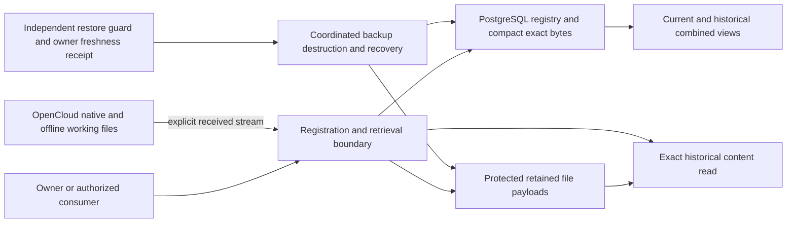

<!-- pgmcp:v1 id=design pv=1.0.0 pf=Uk1D2XWpiag1c6nn sf=WI5iXHBKVOU91bYE -->

# MyBrain storage foundation design

**Status:** Complete Design candidate — independent review requested  
**Version:** 1.2  
**Last Updated:** 2026-10-28

## Purpose

Specify an implementable source-registration foundation from coarse responsibilities to precise storage, operation and recovery contracts. This candidate completes the design surfaces; independent QA determines feasibility/conformity and phase-exit readiness. No implementation, deployment or Planning transition is implied.

## Authority and scope

[Research and its Approved Strategy](research.md) at commit 71a1a6c is the independently reviewed basis. [ADR0001](../../architecture/decisions/0001-digital-brain-foundational-principles.md) and the [discussion map](../../architecture/digital-brain-discussion-map.md), revision 1.12, govern requirements and remain unchanged.

Design includes universal source registration, immutable component history, current/historical composition, metadata/label/representation registration, generic retrieval, exact byte preservation, concurrency, owner control and coordinated custody/recovery. Source-specific automatic intake, reasoning, LLM/vector calculation, presentation, consumer export formats and actions remain outside except for their generic stored inputs/results. Issue5, its trial and earlier Wikibase/SQLite proposals remain separate. No live migration or compatibility break is authorized.

## Architecture decision

Choose PostgreSQL 18 core for the registry, compact exact source bytes, immutable component revisions, head-selection history and operational recovery records. Use registrar-owned retained POSIX files for larger payloads. OpenCloud 7.2.4 remains the mutable native/offline working-file service, not the permanent authority for MyBrain versions.

The retained-file namespace is separate from OpenCloud mounts, shares and client synchronization. It implements the payload boundary, not a second knowledge database. Current files remain accessible through OpenCloud/native desktop applications, including offline working copies. Historical admitted bytes are retrieved through MyBrain by immutable payload/version identity. Automatic capture of every local/OpenCloud edit is deferred to future intake; explicit admission preserves actual received bytes and honestly records unknown upstream-version binding.

## Normative contract map

Each concern has one normative definition. Other documents summarize or link it; they must not introduce incompatible duplicate types.

| Artifact | Normative responsibility |
| --- | --- |
| [Registration model](storage-model.md) | Scalar/role body types, tables, keys, null/cardinality/ownership rules, exact reference semantics, revision/head history and composition. |
| [Operations](storage-operations.md) | Closed HTTP envelopes/responses/errors, preparation/publication/idempotency/CAS, branches, selectors/pagination, owner session controls and protected release boundary. |
| [Preservation and recovery](storage-preservation.md) | Filesystem durability and reconciliation, custody control records/locks, explicit destruction guarantees and joint backup/restore. |
| [Acceptance specification](storage-acceptance.md) | Independent synthetic behavioral oracles, requirement mapping and native implementation admission evidence. |

The model owns record-body semantics; operations owns transport envelopes; preservation owns operational custody records. Trusted validators implement admitted contract profiles, never execute arbitrary stored contract text. Language-neutral JSON/HTTP and relational contracts deliberately do not choose an incidental application framework.

## Source registration and composition

An enduring item has immutable revisions. Exact content Payloads retain bytes; metadata sets, definitions, assignments, relationships, representations, packages/receipts and bindings have separately versioned identities. Definitions retain origins; assignments pin the definition actually used. Confidence belongs to a particular assessment, never globally to label meaning or truth.

Bindings can describe any registered item, including a contract or definition. Their exact subject/member references preserve history; identity-only links intentionally retain stable identity. General semantic relations may cycle; parent/containment/derivation dependencies must be acyclic. Scope-specific completeness and current custody are separate from content identity and substantive applicability.

A combined registered view is (item_id,publication_UUID). The publication coordinate changes even for unrelated writes, so the actual selected composition has a separate fingerprint excluding unrelated changes. Head-selection history reconstructs content and selected bindings; member references remain pinned. Updating one label/set stores changed revisions and selections only. An optional ordinary manifest records actual used members for an action/analysis; ordinary reads and pagination do not create it.

Lifecycle remains ordinary metadata on the same registration before and after admission. Staging is a selector over those registrations, not another repository. A null-content candidate may later receive bytes without another source identity; operation staging alone is private command recovery, not a candidate authority.

## Atomic publication and failure behavior

A durable operation intent precedes payload I/O. Exact compact bytes use bytea; normalized JSONB cannot replace original serialization. Payloads above 1 MiB use the protected archive. Exclusive creation, same-filesystem no-replace promotion, file/directory fsync and attempt fencing establish readiness before publication.

One PostgreSQL transaction validates references/contracts/expected heads, inserts revisions and bindings, selects heads, admits ready payloads and records the operation result. The serialized publication clock is held until commit; sequence numbers/timestamps alone never prove commit order. CAS includes prior selection-publication UUID to prevent ABA. Unselected branches may start from an older same-item revision; explicit later selection still uses CAS.

Failure preserves prior public state and pending evidence. Lost responses resolve by original operation identity rather than duplicate receipt/source creation. Crashed or conflicting work does not trigger automatic orphan deletion. Missing/corrupt bytes, unknown references and incomplete capture remain explicit rather than silently substituted.

## Owner control and preservation

Phase1 has one owner, global owner-authorized sessions and internal least privilege. No multi-party entity-rights architecture is introduced. Future bounded disclosure routes need their own admitted scope and cannot bypass current release controls. Other applications' native sessions and bytes already delivered are outside the owned route's revocation guarantee.

Protected metadata/content release is split into bounded units serialized with revocation and destruction barriers. Current control checks never come from historical query snapshots. Session creation and control rotation serialize on the same owner-control row, preventing an old credential from creating a valid session after rotation.

Destruction requires an exact owner-approved preview, handles shared dependencies and known copies explicitly, and distinguishes requested scope from verified result. Baseline adapters support a declared managed-object guarantee; physical-media erasure is rejected as unsupported. SQL DELETE, VACUUM and unlink are not presented as secure erasure. Out-of-reach copies remain pending.

Coordinated backup binds one exported database snapshot to all exact retained objects and writes completion last. Offline restore preserves surviving UUIDs, reconciles effects/destruction and changes service incarnation before reopening. The restore guard requires an independently retained owner freshness receipt: HMAC proves journal integrity, not that an older whole journal was not replayed. Failure to establish current authority keeps recovery offline.

## Alternatives and trade-offs

| Alternative | Benefit | Decision |
| --- | --- | --- |
| Native OpenCloud versions as permanent source history | Fewer retained objects. | Rejected: inspected native behavior does not establish permanent immutable version references or all-edit capture. |
| Protected OpenCloud retention namespace | Existing file API. | Not selected for v1: proving overwrite/delete/admin bypasses and retention adds integration risk; ordinary permissions are not WORM. |
| All bytes in PostgreSQL | One transactional domain. | Limited to compact bytes: large payload limits and native file workflows favor a generic external payload adapter. |
| Full event sourcing/custom persistent membership tree | Replay and structural sharing. | Not required: immutable revisions and head-selection history avoid full-copy cascades with fewer mechanisms. |
| PostgreSQL registry plus protected retained namespace | Incremental history, exact references and native work coexist. | Selected: requires explicit durable preparation, custody fencing and coordinated recovery, specified here. |

## Dependencies, test design and limits

PostgreSQL 18 core needs no temporal/vector extension. The retained adapter requires Linux exclusive/no-follow creation, no-replace same-filesystem promotion and directory fsync. OpenCloud compatibility evidence is pinned to 7.2.4/reva 2.46.8 for explicit working-file routes; native upload is not treated as a retention guarantee. Primary evidence and counterexamples are linked in the normative contracts.

Exact application language/framework/driver, patch/image digests, kernel/filesystem configuration and test harness must be admitted under repository policy before implementation evidence counts. These deployment pins do not alter the defined semantics. Privileged host/storage administrators remain trusted; this is not hardware WORM or proof of absolute secrecy.

The acceptance specification defines 26 synthetic journeys, independent expected bytes/member selections, two-tool concurrency, branching, mixed-store failures, release races, destruction/backups and rollback recovery. Unit-level deterministic failure models and real-adapter restart/fault evidence complement each other; neither test declarations nor a healthy container count as proof.

This task ran documentation validation and producer consistency/privacy review only. No application tests, benchmarks, live data imports, migrations, runtime changes or NAS operations were executed. Implementation requires evidence for native durability, privilege and release boundaries before any product-readiness claim.

## Planning consequences and remaining scope

Planning can derive implementation boundaries directly from the four normative contracts and acceptance IDs. No further owner policy decision is identified within this bounded v1. Native admission/proof obligations remain mandatory work, and independent Design review may identify corrections.

Source-specific automatic capture, semantic assessment/LLM consumers, ANN indexes, presentation and native-client integrations beyond the stated working-file boundary remain separate future work. They must consume the same generic registration/history/custody contracts rather than replace source authority. This candidate does not schedule implementation cycles or authorize production execution.

## Version History

| Version | Date | Author | Changes |
| --- | --- | --- | --- |
| 1.0 | 2026-10-28 | Codex (@imp designer) | Start the storage Design discussion from reviewed Research; record logical boundaries and unresolved contracts without selecting a technical implementation. |
| 1.1 | 2026-10-28 | Codex (@imp designer) | Establish the logical registry/history model and justify PostgreSQL plus protected retained payloads alongside OpenCloud working files; remaining contracts in progress. |
| 1.2 | 2026-10-28 | Codex (@imp designer) | Complete the bounded design candidate with normative model, wire/publication, custody/recovery and acceptance contracts; request independent review without claiming runtime readiness. |
