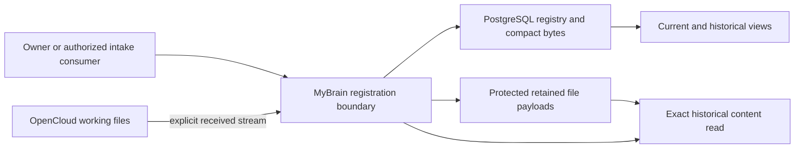

<!-- pgmcp:v1 id=design pv=1.0.0 pf=Uk1D2XWpiag1c6nn sf=WI5iXHBKVOU91bYE -->

# MyBrain storage foundation design

**Status:** Design in progress — logical model checkpoint  
**Version:** 1.1  
**Last Updated:** 2026-10-28

## Purpose

Develop a complete source-registration design from accepted principles to concrete contracts. This checkpoint fixes the logical model; operation, preservation and acceptance contracts are still being completed. It is not a Design-exit verdict or implementation permission.

## Authority and scope

[Research and its Approved Strategy](research.md) at commit71a1a6c is the reviewed basis. [ADR0001](../../architecture/decisions/0001-digital-brain-foundational-principles.md) and the [discussion map](../../architecture/digital-brain-discussion-map.md), revision1.12, govern requirements. No principle or historical report is amended.

Design includes logical records, concrete storage/interface contracts, concurrency, preservation/recovery and behavioral validation. Source-specific automated intake, interpretation, AI/vector calculation, presentation, consumer exports, production implementation, deployment and live migration remain outside this design except for their generic stored inputs/results. Issue5 and its earlier proposed stack remain separate.

## Architecture decision

Choose one PostgreSQL18 registry for compact exact source bytes, immutable component revisions, head-selection history and operational recovery records. Use registrar-owned retained files for larger payloads. OpenCloud7.2.4 remains the mutable native/offline working-file service, not the authority for permanent MyBrain versions.

The retained-file namespace is separate from ordinary OpenCloud mounts and client synchronization. It is an implementation behind the source-payload interface, not another knowledge database. Current files remain accessible through OpenCloud and native desktop applications; historical admitted bytes are retrieved through MyBrain by immutable payload/version identity. Automatic capture of every local or OpenCloud edit is not promised. Explicit admission preserves the actual received bytes, with uncertain upstream-version binding visible.

## Alternatives and trade-offs

| Alternative | Benefit | Rejected or limited because |
| --- | --- | --- |
| Treat native OpenCloud versions as permanent identity | Fewer additional retained objects. | Inspected revision/capture behavior does not establish immutable permanent source-version references. |
| Protected OpenCloud retention namespace | Existing file API can hold snapshots. | Requires proving all overwrite/delete/space-admin bypasses and retained-byte behavior; native file permissions are not WORM. |
| Put all content in PostgreSQL | One transactional content/registry domain. | Large payload limits and ordinary native-file workflow make this an unnecessary universal requirement. |
| Full event sourcing or a custom persistent membership tree | Reconstructible history and sharing. | Immutable row revisions plus head-selection history satisfy current requirements with fewer custom mechanisms. |
| Selected registry plus retained-file namespace | Exact references, small incremental changes, ordinary file use preserved. | Requires explicit durable file preparation before atomic registry publication and coordinated backup/destruction. |

## Logical source model

The normative [model and constraints](storage-model.md) distinguish:
- enduring items from their immutable revisions;
- received payload bytes from parsed/derived descriptions;
- package/receipt occurrences from source identity;
- definition/origin from assignment/assessment;
- independently versioned metadata sets, relationships and representations;
- selected historical combined state from a changing current view.

A source's combined registered version is (source_id,published_commit_id). PostgreSQL head-selection history reconstructs its selected content and bindings at that basis; exact member references do not float to later component heads. Adding a label stores only changed revisions/selections/bindings, not a duplicate of every source component. An explicit result manifest freezes actual chosen revisions when used by an action or analysis.

The publication clock is transactionally locked and updated, never a bare sequence or timestamp. Head CAS includes the prior head-selection commit as well as revision ID, so moving back to an old revision cannot trick a stale client.

## Contract completion still in progress

The next authored contract surfaces specify exact command/query envelopes, idempotency, byte preparation and atomic publication, recovery/destruction/backup boundaries, release authorization and independent behavioral oracles. Routine engineering decisions remain subject to Research strategy; genuine owner-policy conflicts return to Co.

No application runtime or API framework is selected merely by using language-neutral JSON/HTTP and relational contracts. Stored contracts remain inert data; activating a validator or processor requires separate trusted authority.

## Version History

| Version | Date | Author | Changes |
| --- | --- | --- | --- |
| 1.0 | 2026-10-28 | Codex (@imp designer) | Start the storage Design discussion from reviewed Research; record logical boundaries and unresolved contracts without selecting a technical implementation. |
| 1.1 | 2026-10-28 | Codex (@imp designer) | Establish the logical registry/history model and justify PostgreSQL plus protected retained payloads alongside OpenCloud working files; remaining contracts in progress. |
