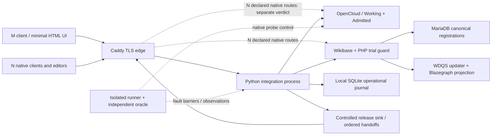

<!-- pgmcp:v1 id=design pv=1.0.0 pf=Uk1D2XWpiag1c6nn sf=WI5iXHBKVOU91bYE -->

# OpenCloud–Wikibase trial design

**Status:** Proposed trial design  
**Version:** 1.0  
**Last Updated:** 2026-10-24

## Purpose

Specify a reproducible synthetic trial that can falsify the provisional pair's capture, meaning-history, access and recovery fit before production adoption.

## Scope In

Trial architecture, admission locks, identities/fixtures, interfaces, operational state, preservation and release contracts, fault controls, G1–G8 scenarios and separate managed/native verdicts.

## Scope Out

Installation, application implementation, runnable manifests/scripts/tests, live/private intake, production architecture adoption, original issue-5 mail/NAS work and workflow progression.

## Problem Statement

The gap assessment identifies substantial reusable file/claim machinery but no demonstrated complete capture, versioned meaning, historical-result, revocation or combined-restore guarantee. This design fixes the choices needed to implement an honest trial, including deliberate negative controls. It authorizes no installation or product adoption and is not an Approved Strategy, issue plan or phase exit.

## Functional Requirements

- Distinguish observed/received, recognized, preserved, semantically registered and processed outcomes; do not acknowledge capture or registration before the corresponding durable evidence exists.
- Preserve reusable definition origin/version separately from uncertain, contested or withdrawn applications; retain actual Q_A basis/result after explicit changes produce Q_B.
- Evaluate managed API and actual native web/desktop/mobile routes separately, including bypass, crash, response-loss, restoration and scoped destruction.
- Provide a clean minimal status/context interface and later reusable domain API, with deterministic processing rather than an external model prerequisite.

## Nonfunctional Requirements

- Use only synthetic run-scoped data on an isolated admitted Linux x86_64 host; no production NAS, development-harness environment, private source or credential copied into artifacts.
- Use explicit source/configuration/dependency/OCI-platform locks before execution; unresolved admission fields cannot be treated as a pinned tested stack.
- Keep canonical knowledge/policy registrations in Wikibase and authoritative admitted bytes in OpenCloud; SQLite is an operational journal/fence, not another knowledge or policy database.
- Apply frozen DTOs, narrow read-only interfaces, constructor injection, pure state queries and explicit effectful commands; preserve diagnostics without leaking protected existence or secrets.

## Decision

The trial uses one Python 3.14 integration process, FastAPI/Pydantic 2/HTTPX, stdlib SQLite rollback journal DELETE with synchronous EXTRA on a local volume, OpenCloud 7.2.4 with bundled Web 7.1.5, a reduced five-service Wikibase Suite baseline and one Caddy 2 TLS edge. These are trial-only choices. Managed profile M and native profile N have independent verdicts; an M pass never proves native interoperability or whole-product P30.

## Rationale

A single coordinator makes operation/fence ordering observable while reusing clients, file services and claim editors. Explicit sealed versions avoid introducing another temporal knowledge store. Critical native capture, append and release routes remain experiments. Supported Python/SQLite mechanisms reduce driver complexity, but their durability still requires host admission and failure evidence.

## Test Design

All scenarios below are **planned, unexecuted**. The [gap assessment](opencloud-wikibase-gap-analysis.md) supplies the full principle/aspect mapping; this design adds trial contracts rather than repeating that matrix. The accepted ADR remains the production conceptual authority.

| Profile/result class | Meaning |
| --- | --- |
| M managed | Domain API/controlled release; ordinary test clients cannot reach raw backends. Proves only the admitted managed boundary. |
| N native | Real OpenCloud web/desktop/mobile and Wikibase UI/API identities/routes, with declared gate/adaptation. Native behavior must actually be exercised. |
| Stock negative control | Separate cloned fixture/profile without the own guard/fence. Expected invariant failure demonstrates a valid counterexample/control, never compliance. |
| PASS | Every predeclared required oracle and route for that case/profile is evidenced and satisfied. |
| FAIL | A required invariant is contradicted: leaked post-R handoff, wrong acknowledged bytes, forbidden mutation, false completion or wrong historical result. |
| INCONCLUSIVE | Required route/device, barrier, authoritative evidence, reconciliation or host capability is unavailable/unproved. A safely contained in-doubt operation is not successful recovery. |
| N/A | Predeclared exclusion with rationale; never selected after seeing a failure and never used for required N client routes. |

The run report has independent M and N case rows, exact route/device inventory, actual observations and exclusions. A disabled route records a network/permission denial, not proof that its native implementation is safe. Native unfenced passthrough leaves G2-N FAIL or INCONCLUSIVE; Caddy's ordinary proxying does not supply a release fence. No overall adoption recommendation follows while required N routes remain unproved.

The independent runner holds literal fixture oracles and expected memberships; SUT output must not generate its own expected answer. Each evidence record identifies run/profile/case/step, operation/principal ID, API/transport version, request digest, expected and observed entity/revision, artifact digest/length, named fault/barrier and native response/commit observation. Secret token values and source canary content stay out of logs; use IDs, digests, lengths and scoped diagnostics.

## Contracts

### Trial host, components and trust boundaries

Default target: an isolated single-host Linux x86_64 VM with local ext4 supporting xattrs, Docker Engine and Compose v2. The planning allocation is **8 vCPU, 16 GiB RAM and 80 GiB disk**; it is unmeasured and is neither a vendor requirement nor a performance result. Actual capacity, filesystem behavior and resource limits are host-admission facts. No existing NAS directories, PGMCP runtime/environment or host-wide credentials are mounted.

| Component/boundary | Fixed trial responsibility and exposure |
| --- | --- |
| Caddy 2 edge | One trusted trial-CA TLS edge; logical domains oc.brain-lab.test, kb.brain-lab.test and api.brain-lab.test. Core reverse proxy only, no assumed custom fence plugin. |
| Integration process | Domain commands, authorized pure status reads, archive adapter, semantic adapter, deterministic processor, query preparation and controlled release. One writer/coordinator; fault controls on a separate isolated control channel. |
| OpenCloud | 7.2.4/reva 2.46.8, bundled Web 7.1.5, built-in IDP/IDM, POSIX noncollaborative storage. Working and Admitted are separate Spaces on the same backend. |
| Wikibase and jobs | Same selected Wikibase image for wiki and jobrunner; MariaDB 10.11 family for canonical entities/revisions/policy bindings. Keep Suite bootstrap/LocalSettings extension seam. |
| Query projection | WDQS container includes Blazegraph; separate updater uses the same image. Projection is rebuildable; finite-manifest queries do not rely on its completeness. |
| Omitted services | OpenSearch, QuickStatements and SPARQL frontend are absent. Reuse OpenCloud's NATS rather than adding an event broker. No Kafka, external identity product, separate knowledge database or real-model service is introduced. |

M publishes domain operations only. N deliberately enables the declared native routes through the edge and uses real platform accounts; any missing gate remains a measured gap. Backend ports, MariaDB, query store, NATS and the control channel are not reachable by ordinary clients. Access from the trusted maintainer/runner network is recorded separately, not counted as an ordinary-user protection.

Named local volumes hold OpenCloud configuration/metadata/blobs/xattrs, MariaDB, rebuildable query data, SQLite plus its rollback journal, pending staging and run evidence/backups. Secrets/configuration are distinct read-only mounts where supported. The staging area is pending-operation material, not a second authoritative archive. No client receives an Admitted write/restore/purge route. The registrar's scoped account is still trusted code with write capability, not claimed WORM storage.

All public origins use HTTPS on port 443: oc.brain-lab.test, kb.brain-lab.test and api.brain-lab.test. M binds loopback only; N binds the separately admitted private interface with allowlisted devices. OpenCloud OC_URL/IDP issuer, Wiki public URL, Caddy routes, DNS and certificate names use those same origins. Remote M access/tunnels require explicit admission without changing the issuer/origin silently. No Internet exposure or TLS verification bypass is allowed. Actual DNS, CA trust and real-mobile admission remain unperformed; a desktop viewport cannot establish mobile PASS.

### Version baseline and admission lock contract

[OpenCloud compose stable-7.2](https://github.com/opencloud-eu/opencloud-compose/blob/097e0d8c6e9848ad7d8082f823fed5884f53c73a/docker-compose.yml) selects backend 7.2.4; its [Web build pin](https://github.com/opencloud-eu/opencloud/blob/1770793f2657e153836c32d32dd6d256b8531d3d/services/web/Makefile) selects 7.1.5. Keep versioning enabled, filesystem watching/revisions disabled and personal/project automatic purge ages zero. These settings protect a trial route, not every original against explicit restore/purge.

The reduced [Suite source](https://github.com/wmde/wikibase-suite/blob/b4208963b9df586bee979a07e5130c92756f46ee/docker-compose.yml) is source-supported but unstarted. Use wikibase + wikibase-jobrunner, MariaDB, wdqs + wdqs-updater. Remove omitted-service dependencies, environment, volumes and routes coherently; ELASTICSEARCH_HOST and QUICKSTATEMENTS_PUBLIC_URL are absent on a fresh volume. Retain bootstrap and the extension seam rather than replacing MW_CONFIG_FILE. The [image configuration](https://github.com/wmde/wikibase-suite/blob/b4208963b9df586bee979a07e5130c92756f46ee/development/images/wikibase/README.md) supports these omissions. The [defaults](https://github.com/wmde/wikibase-suite/blob/b4208963b9df586bee979a07e5130c92756f46ee/development/images/wikibase/runtime/var/www/html/extensions/WikibaseSuite/config/DefaultSettings.php) require the jobrunner. Internal anonymous reads remain enabled for the stock [updater](https://github.com/wmde/wikibase-suite/blob/b4208963b9df586bee979a07e5130c92756f46ee/development/images/wdqs/runUpdate.sh); anonymous writes remain disabled. This is network containment, not object authorization.

| Baseline | Source/recipe constraint before resolving runtime images |
| --- | --- |
| OpenCloud | 7.2.4, source 1770793f2657e153836c32d32dd6d256b8531d3d; reva e54d2d903dbd331c8f103ddad39ab2b6ecd1d054; compose 097e0d8…; Web 7.1.5. |
| Wikibase Suite | 8.0.1 source b4208963b9df586bee979a07e5130c92756f46ee; Wikibase image recipe 8.1.0, MediaWiki 1.46.0/PHP 8.3.23; Wikibase eaa851d89d36136ab718f1fe5fa81a8b770c0d59. |
| WDQS | Image recipe 2.2.0; query service 0.3.165; Blazegraph bundled. Wiki/jobs share one resolved image; query/updater share another. |
| Trial service | Python 3.14 supported branch; FastAPI, Pydantic 2, HTTPX and stdlib sqlite3. Exact patches, transitives and distribution SQLite build are unresolved until admission. |
| Other runtime | MariaDB 10.11 family, Caddy 2 stable family, Docker Engine/Compose v2; exact supported patches and platform digests require admission. |

Python 3.14 is a [supported bugfix branch](https://devguide.python.org/versions/); its [stdlib SQLite interface](https://docs.python.org/3.14/library/sqlite3.html) still depends on the distributor's SQLite build. This environment is separate from MyBrain's development harness.

The future lock record schema is trial-bom/1. Required fields are source repository/commit and patches; service/configuration digest; image reference, registry index digest, linux/amd64 child-manifest digest, image/config IDs, build source/base attestations; exact Python/library/SQLite version and SQLite source ID; complete hash-locked dependencies/licenses; own service/guard revisions; Engine/Compose versions; fixture/contract manifests and public CA fingerprint. Resolved values are mandatory, with explicit reasoned N/A only where genuinely inapplicable. UNRESOLVED, empty fields or moving tags prevent runtime admission.

A build record must link those locks to actual image inspection and Special:Version/runtime observations. Source recipe selections are not evidence of image contents. Any mismatch requires reconciliation/redesign, never a silent upgrade. A mandatory smoke gate proves fresh startup, native CRUD, jobrunner and updater operation before G scenarios. No digest, patch lock or compatibility result is claimed here.

### Synthetic principals and exact fixture admission

Identifiers are run-scoped URNs, `urn:mybrain:trial:<run>:<object>`; native Wikibase Q IDs and OpenCloud IDs are separate confirmed mappings. No production identifiers are reused.

| Principal | Fixed authority |
| --- | --- |
| maintainer | Isolated host/database/control-plane administration, outside the ordinary-user boundary. Bootstrap/maintenance actions are recorded. |
| owner | Scoped corrections, policy revocation and an explicit named destruction request. Historical preservation does not remove that authority. |
| registrar | Ordinary OpenCloud account with Working read/Admitted write; Wikibase bot editing only fixture records, without ordinary delete/import/admin privileges. No unqualified least-privilege claim. |
| reader | Initially reads A_v1, dependent W_v1/Q_A and the explicit large-stream fixture binding; loses that binding through revocation. Owner remains authorized. |
| outsider | Authenticated but denied; inaccessible and absent handles produce the same generic unavailable response. |
| runner | Isolated fault control/oracle. Its evidence is not available to the SUT's reconciliation logic as a shortcut. |

M uses lab-issued opaque bearer credentials; the server derives the principal from the authenticated credential. A supplied principal_context_ref must match that identity and cannot grant owner authority. These tokens are separate from upstream credentials and prove no SSO correspondence. N uses actual platform identities. Evidence records token IDs, never secret values; header/body/status/evidence access follows the same policy scope.

| Fixture | Exact bytes or fixed meaning |
| --- | --- |
| A_v1 / A_v2 / A_v3 | UTF-8 alpha-v1, alpha-v2, alpha-v3 respectively, each followed by one LF: 9 bytes each. Collision variant supplies mtime 2026-01-01T00:00:00Z; another uses distinct times. |
| B_v1 / C | B_v1 has A_v1's exact bytes but independent continuing identity. C is an explicit copied exemplar with lineage; equal hash alone does not merge identities. |
| O_v1 / D_v1 | O_v1 is octets 00–FF once, 256 bytes. D_v1 repeats that sequence 65,536 times, exactly 16 MiB, for bounded streaming. |
| P | One-page PDF reading “Synthetic trial source”; generator/version/timestamps and actual bytes/digest locked at fixture admission. No guessed PDF hash. |
| W_v1 / W_v2 | W_v1 is UTF-8 “Synthetic context W_v1 uses A_v1.” plus one LF. W_v2 is UTF-8 “Synthetic context W_v2 uses A_v2.” plus LF, separately admitted after explicit processor-v2 activation, never an overwrite. |
| Z_v1 | UTF-8 destroy-only-v1 plus LF, dedicated to scoped destruction; no shared bytes with A/B. Any WZ derivative is explicitly listed. |
| L_v1 / L_v2 | “Relevant to Project Alpha” versus “Relevant to approved Project Alpha decisions”; fixture meanings only. L's original origin remains W_v1. |

Literal bytes and independent expected digests/lengths are locked before ingestion. Include two offline clients editing A divergently and a real mobile/new-device fixture. The fixed deterministic processor v1 emits exactly W_v1 for A_v1 under its activated contract; no external LLM is required.

AP1 applies L_v1 to A_v1 with E1 fit uncertain and temporal applicability undetermined; recorded_at is known. APW separately applies L_v1 to W_v1 with applicable EW. Origin in W does not itself label W. AP2 retains a competing not-applicable assessment without automatically defeating AP1. E2 explicitly withdraws AP1 for trial-current at a known effective boundary and records its reason/supersession. K1 admits applicable/uncertain candidates, visibly including unknown applicability; K2 admits applicable only. No universal confidence score or per-assignment rationale chain is introduced.

### Trial data contracts and module interfaces

All request/response DTOs are strict frozen Pydantic 2 models; unknown fields are rejected. The trial schema version is trial-contract/1, not a production ontology. Domain facts are structured; the presentation layer owns readable messages. Constructor-injected ports isolate byte storage, semantic storage, journal, clock, policy resolver, controlled sink and fault controls. Read-only consumers receive only readers.

| DTO | Required trial fields/invariant |
| --- | --- |
| OperationIntent | run_id, caller-generated UUID operation_id, kind, object_id, contract_ref, validated body, principal_context_ref. Request fingerprint uses trial-json/1: JSON objects and ordered arrays; recursively sort ASCII object keys, preserve array order, and encode UTF-8 with minimal separators. Scalar leaves are integer/string/bool/null; no string normalization or floats. |
| ArtifactRef | domain version URN, preservation_kind bytes/reference, sha256 and byte_length for retained bytes, media_type, acquisition_evidence_ref and confirmed OpenCloud object mapping. Native version URLs are evidence, not stable authority. |
| EntityRef | site namespace, native entity ID and exact revision; statement GUID where used. No floating dependent definition/source references. |
| RegistrationIntent | OperationIntent plus role, sealed body, artifact_ref where relevant and expected_entity_revision. New uses zero as a trial sentinel, not a client-selected Q ID; mutable view changes require an exact parent. |
| OperationSnapshot | intent/request fingerprint, independent milestone evidence, outcome, attempt count, confirmed mappings, native diagnostics/evidence references. Never synthesize semantic truth from editor/bot identity. |
| QueryIntent/Result | exact edition, selection/response/activation refs and parameters; actual used refs, completeness judgment, result ArtifactRef and constructed state. Separate append-only release events reference the sealed query; a history projection assembles attempts without changing it. |
| Policy/ReleaseIntent | registered policy binding/version refs, declared scope, authenticated principal and result/range. SQLite keeps fence epoch/pointers/intent, not a second current policy definition. |

| Public interface signature | Contract |
| --- | --- |
| IntakeCommands.submit(intent) → None | Durably reserves intent and handles receipt/capture work; status is read separately. |
| RegistrationCommands.register(intent) → None | Calls the guarded trial PHP endpoint; saves confirmed mapping or explicit uncertainty. |
| ContractCommands.activate(intent) → None | Activates an exact stored contract/interpreter/scope; storage alone never activates it. |
| QueryCommands.prepare(intent) → None | Builds and preserves a result/manifest; cannot silently release it. |
| PolicyCommands.revoke(intent) → None | Performs the R fence and canonical-policy reconciliation below. |
| ReleaseCommands.release(intent, controlled_sink) → None | Explicit effectful release path; no hidden mutation inside a state query. |
| OperationQueries.get(run, operation, principal) → OperationSnapshot | Pure authorized read; missing/inaccessible handles share the generic unavailable projection. |
| ArchiveReader.read(ref, offset, length) → bytes | Pure narrow reader; no save/checkpoint side effect. |
| SemanticReader.get_exact(ref) → FrozenEntity | Authoritative exact-version read, not WDQS absence inference. |
| LabControl.pause_or_fail(hook, fixture, operation) → None | Isolated control plane only; ordinary clients cannot invoke fault controls. |

Queued mutations use POST /operations/{clientUUID}, return HTTP 202 plus the operation handle after durable reservation, and expose authorized pure GET /operations/{id}. A 202 is acceptance, not capture/registration completion. Same key/same fingerprint resumes or returns the original receipt; same key/different fingerprint conflicts. State reads never advance work. Result release is separate: POST /operations/{clientUUID}/release executes ReleaseCommand with a controlled bounded sink and may return HTTP 200 streaming. Authentication failure is 401; authenticated absent/inaccessible handles share generic 404 body. This defines content/existence behavior, not timing-side-channel proof.

The PHP trial module supplies primary operation lookup and sealed-role enforcement. It guards authoritative OLD role/seal/origin state, so removing a seal in proposed content cannot bypass protection. Lower save, import, merge/datatype, deletion/suppression and admitted maintenance paths are inventoried explicitly; ordinary import/delete rights are absent. Strict own mutations compare the exact parent used by native CAS and reject stale parents; Action baserevid auto-merge is not that contract. A unique operation-key mapping is not assumed atomic with entity saving: G4 must prove coupling/recovery, otherwise the result remains in doubt. No core fork is presumed necessary or claimed proven.

### Finite editions, processing and exact query oracles

K1/K2 and the bootstrap property mapping are registered versioned artifacts. Activation records name contract version, deterministic interpreter v1, configuration and run scope. The processor reads A_v1 and emits exactly W_v1 under that activation. Reprocessing produces W_v2 with its own basis; it cannot overwrite context, owner correction or historical result.

M1 is a sealed finite list of every required source/definition/application/assessment/contract/entity revision and artifact digest. The coordinator reads all M1 members directly from primary/exact-version APIs and verifies dependency closure. It does not claim a wall-clock snapshot of all Wikibase entities. Immutable version/event items remain in the current full statement graph; WDQS is a rebuildable projection and must never supply a safe negative absence oracle.

| Query/check | Fixed independent oracle |
| --- | --- |
| Q_A, M1, K1, exact L_v1 | Selected set exactly {A_v1, W_v1}; E1 uncertainty/temporal unknown and AP2 alternative remain visible through authorized result metadata/manifest. APW is explicit. |
| Add K2/L_v2 before E2 | K1/M1 remains {A_v1, W_v1}; stored Q_A is unchanged. Storing another contract does not activate it. |
| Pre-E2 explicit K2 query | A separate manifest/activation reuses M1's exact factual versions and L_v1, activates K2 and selects {W_v1}. M1/K1 and Q_A remain {A_v1, W_v1}; M1 is never mutated. |
| E2 then current M2 with K1 | Exactly {W_v1}; explicit scoped withdrawal changes AP1 applicability, not a timestamp or definition revision alone. |
| Q_B, M2, K2, exact L_v1 | Exactly {W_v1}; A_v2/L_v2 receive no implicit application/rebinding. |
| Historical M1/K1 after all changes | Exactly {A_v1, W_v1}; actual recorded Q_A remains byte-identical. Current rights still govern disclosure. |

The canonical result body is sorted version-URN lines encoded UTF-8 with exactly one final LF; the oracle compares both membership and exact bytes. The result metadata identifies uncertainty and links an authorized full basis manifest; selection descriptions need not all be copied into the canonical body. The manifest retains actual used versions/assessments, methods, scope, contract/activation/processing refs, completeness and constructed result digest. Its historical rights evidence grants no present access.

Broader current-graph querying is a separate case: while the updater is paused, add an eligible fixture entity outside M1 and query the declared whole fixture scope. A missing hit cannot be called complete. Finite-edition success does not remedy that gap; unknown coverage is honest but not a full-graph completeness pass. No second authoritative store is added automatically.

### Release fence and trial access propagation

For this fixture only, W_v1 and Q_A require all of A_v1's reader rights; D_v1 has an explicit binding to that same revocable right for multi-chunk release. This conservative dependency intersection is not a universal production propagation policy. The first response contract denies the whole result if any required member is unavailable; it does not leak denied member counts. Owner remains authorized.

Each policy/version binding is registered with the source/derived objects in Wikibase. Native OpenCloud ACLs add enforcement. The coordinator resolves those canonical refs; SQLite's scope fence/epoch is operational state. Every in-scope native policy mutation must enter the same fence or an adapted route. An uncoordinated native route fails G2-N; network closure in M proves nothing about native usability.

R is the first durable whole-scope blocking point: under the exclusive coordinator barrier, persist the closed scope and advance its ordered epoch. Then commit/reconcile the registered Wikibase policy changes and native enforcement. Successful revoke acknowledgment requires consistent binding/policy/epoch; partial updates keep the entire declared scope closed/in doubt. There is no cross-database transaction claim. Restart begins closed and reconciles before opening.

Each release handoff and revocation share that exclusive barrier. Maximum chunk is **16 KiB** and initial sink-write deadline **5 seconds**, trial constants rather than latency guarantees. There is no generation-long lease. A durable ordered sequence records handoff intent/outcome, chunk offsets/length/digest and epoch, and the R event. Missing or uncertain sink outcomes are retained rather than invented as delivery.

The trial release boundary is the observed handoff into the controlled TLS delivery pipeline, not when a client reads a buffer. Already handed buffers may arrive after R through ASGI/Caddy/socket buffering. The oracle compares the client-visible prefix with exact authorized pre-R handoffs; it does not fail merely from client receive time. Actual handoff observation and bounded offsets/buffering must be demonstrated, not replaced by generator creation or a final check followed by ungated send. If this boundary cannot be observed, G2 is INCONCLUSIVE. This is an explicit trial interpretation for evaluation, not a universal resolution of P30.

Release of small Q_A is denied whole-result after R; D_v1 tests pausing between chunks. Data and control channels are independent so a blocked client cannot hide the revoke operation. Caddy remains an ordinary TLS proxy and cannot manufacture G2-N compliance.

### Entrypoint/run sequence contract

The later implementation supplies named entrypoints, not scripts in this document:

| Entry | Inputs and permitted result |
| --- | --- |
| AdmitRun | Host/route/device inventory, BOM/build record, fixture/contract locks and trusted certificates; returns admitted or blocked evidence. Missing fields never produce PASS. |
| BootstrapSyntheticRun | Fresh volumes, synthetic principals/property mapping and activated trial contracts; seeds sealed finite editions and records exact native mappings. |
| RunCase(profile, case, variant) | Predeclared fixture reset, permissions, hooks and oracle; writes factual evidence and PASS/FAIL/INCONCLUSIVE/N/A for that row only. |
| QuiesceAndExport | Closes intake/release, drains or records pending work, stops OpenCloud and coordinates MariaDB/SQLite cuts before creating the declared backup/export manifest. |
| RestoreClosed | Fresh volumes plus backup and authoritative later control evidence; reconciles before any disclosure. |
| SummarizeRun | Pure read of evidence, preserving M/N/control distinctions and unresolved work; cannot create missing results. |

Before a run: resolve all locks and validate the reduced stack's smoke observations. Seed/reset each case's isolated fixture; establish its positive control and fault-hook order; run the negative control separately; execute the declared profile; collect independent observations and reconcile before resetting. G1/G2/G3 come before a broad implementation commitment, followed by G4/G5/G6/G7 and G8 usability; restore and access checks recur across the slice. This order is a trial execution contract, not an approved issue implementation plan.

The first UI can be minimal HTML forms plus authorized operation/status/history views and existing native editors in N. It displays changed, recognized, registered and processed separately, uncertainty and unknown validity, and unavailable outcomes without exposing denied existence. Future MCP calls use these same domain operations and controls; no SDK/model choice or additional transport implementation is prerequisite.

## Flow

The diagram shows logical responsibilities, not additional mandatory processes. Ordinary-client and maintainer/control trust are distinct.

Intake flows from durable intent through retained receipt, protected archive verification and exact semantic registration. Query preparation consumes a sealed edition and activation, preserves result plus basis, then awaits an independent release command. A response artifact can exist while release is denied. Native N routes are not silently covered by the managed path.

## State and Failures

The journal uses **rollback journal_mode DELETE, synchronous EXTRA**, read_uncommitted off, one serialized writer/process and local Linux storage, never NFS/SMB. Effective settings and actual SQLite version/vendor patch/source ID are read back at admission. [SQLite EXTRA](https://www.sqlite.org/pragma.html#pragma_synchronous) includes directory synchronization after DELETE-journal commit. This revises the earlier tentative WAL choice: the trial does not need WAL concurrency, and [known WAL reset fixes](https://www.sqlite.org/wal.html#walreset) require build-specific verification. WAL is not a silent fallback; using it needs a design revision and verified fixed build. [SQLite isolation](https://www.sqlite.org/isolation.html) supplies native serialization, not cross-system atomicity. SIGKILL/process-restart evidence never proves real power-loss durability.

| Contract | Fixed state rule |
| --- | --- |
| Reservation | Unique(run_id, operation_id), canonical request fingerprint and intent are durable before acceptance. Different payload under the same key conflicts. |
| Progress | Append milestone evidence relevant to that operation: reserved, received, archive_verified, semantic_confirmed, result_prepared, release_attempted. These are not one compulsory semantic pipeline. |
| Outcome | pending, confirmed, rejected or in_doubt. Rejected means established failure/non-admission; uncertain external effect is in_doubt, not a safe retry. |
| New-create attempt | Record the attempt before sending. Lost success or uncertain commit prohibits another native new-create until primary reconciliation establishes the original mapping or sufficient negative evidence. |
| Reconciliation | Supported PHP primary lookup, with native entity/revision evidence. WDQS/search/labels are never a negative oracle. Visible containment can succeed while recovery remains INCONCLUSIVE. |
| Scope fence | OPEN, FENCED or RECONCILING. Partial policy/destruction/restore work keeps the whole declared scope closed. Restart is closed until current evidence is reconciled. |

The minimum fault contract has named barriers before native save after parent selection; after native commit before client response; after archive write before verification; after result construction before release; between release chunks; after R before canonical-policy completion; before/after index updates; and before restart/reconciliation. Faults can deny storage, terminate a process or drop a particular successful reply. Hook placement is proved by native status/commit observations independent of the SUT.

A proxy dropping a reply must first observe the real native success and retain that fact in oracle-only evidence; the coordinator must still reconcile. The native stat/read race probe needs a test-only CS3/gateway relay that pauses after successful Stat and before InitiateFileDownload for the fixture, with an independent overwrite. Pausing an outer HTTP request is not equivalent. If that exact relay seam cannot be configured without a patch, the probe is blocked/INCONCLUSIVE, not passed by substituting the managed payload barrier. Fault endpoints never become ordinary production-style API routes.

## Preservation

First-trial archive assurance covers process/container restart, not host power loss. Intake retains the exact offered payload/receipt in fsynced staging, including directory operations and a durable journal reference. The adapter creates a unique Admitted object and compares full API readback with that retained payload; the independent runner separately compares fixture literals/digests. Readback alone proves no commit durability. Archive verification also requires observed native commit/flush assurance and the declared process-restart/readback evidence before archive_verified acknowledgment. Missing assurance leaves verification INCONCLUSIVE, with staging retained, not a durable-preservation claim. Semantic confirmation separately requires primary Wikibase confirmation and durable mapping; HTTP 202 proves neither.

An uncertain archive write is reconciled without blindly overwriting the object. Fsynced staging remains until archive commit assurance, registration and declared restart/readback evidence all hold; never clean up the sole retained copy. If an acknowledgment depends on staging, that copy is explicitly included in the preservation closure, not a hidden second archive. All staging copies enter destruction inventory. Native acquisition is tested separately; unmatched provider state is retained as uncertain rather than misidentified.

G6 closes intake/release, drains or journals pending work, then stops OpenCloud before copying its configuration/bytes/metadata/xattrs/sidecars, following the [native backup requirement](https://docs.opencloud.eu/docs/admin/maintenance/backup/). Coordinate consistent MariaDB and SQLite cuts, admitted manifests/results and evidence; quiescing only the coordinator is insufficient. Query indexes may be rebuilt. Restore to fresh isolated volumes remains fenced. Restoring B0 after revocation requires authoritative later policy/epoch/revocation evidence on the control plane outside B0, linked to its original registration. Without it, remain closed/INCONCLUSIVE; do not invent current rights.

G7 uses only dedicated Z_v1 and explicitly listed derivatives/named backups. The owner's trial command names the logical payload, registrations/history/derived indexes, archive/export/staging objects and included backup files/volumes. It permits an ID-only destruction marker for this fixture, not a universal retention policy. Any in-scope B0 copy is actually removed/redacted and replaced, with the old copy removed, before completion. A later restore cannot use the removed B0; it fails or names the verified replacement generation. Backups outside the chosen scope are explicitly not claimed destroyed.

The G7 claim concerns recoverable logical objects/bytes in declared SUT stores, not forensic unallocated SSD blocks or undisclosed host snapshots. The independent fixture oracle/control plane is outside that declared SUT scope; run evidence retains hashes/status IDs rather than source canary content. No physical secure-erase claim, actual delete command or destruction has occurred in preparing this design.

## Validation

### G1 — capture, identity and retained versions (P02–P04, P08, P18, P20–P22, P34)

**Method:**

1. Admit A_v1/A_v2/A_v3 through M as unique protected versions; compare acknowledged bytes with independent literals/digests. Add independent B_v1, copy C, opaque O_v1 and P. M does not exercise native revision-key collision.
2. Pause around archive write/commit assurance/verification; deny storage or terminate/restart before completion. Retain staging and prohibit early archive ACK; verify the declared restart model.
3. On a stock/N clone overwrite the SAME Working resource ID A_v1→A_v2→A_v3, once with distinct times and once with forced same mtime. Record actual native ID/time and list revision keys after each overwrite; missing collision injection is INCONCLUSIVE. Then rename/move/copy, restore and delete the current exemplar; probe saved revision links. M's independent Admitted versions must remain correct.
4. Exercise N sync/stat-read acquisition with the exact Stat→InitiateFileDownload relay and an intervening overwrite. Also probe same-path/preserved-mtime external changes separately, without enabling them as an admitted default.

**Expected Result:** PASS requires correct distinct identities/receipts and exact retrievable bytes for every acknowledged admitted version, including after Working restore/delete. Wrong/mixed bytes under a confirmed version, hash-only identity merging or false capture completion FAILS. A native URL counterexample is a negative-control observation, not M failure if protected versions remain correct. Missing exact native race instrumentation makes that N probe INCONCLUSIVE; it cannot be replaced by M upload evidence. Retain native IDs/revisions, acquisition ordering, byte comparisons and crash milestone evidence.

### G2 — release/revocation and bypass scope (P13, P17, P30–P32)

**Method:**

1. Positive control: reader receives authorized D_v1/Q_A; outsider gets generic unavailable responses for absent/denied handles. Verify M backends are unreachable. Spoof owner principal_context_ref under reader credentials for revoke/destruction: deny without policy/payload effects.
2. Prepare a result, pause before release, revoke A's declared binding through owner command and resume. Small Q_A is denied whole-result.
3. Stream D_v1, pause after the first observed controlled handoff and before the next barrier acquisition; commit R on the separate control path, then resume. Repeat while paused after R but before policy reconciliation and across restart.
4. In N use real platform tokens for native downloads/previews/thumbnails, public links if enabled, WB entity/API/history/export and WDQS/count paths; include stale sessions and every admitted native policy mutation. Run an unfenced stock counterexample separately.

**Expected Result:** PASS for each profile requires no revoked-right handoff ordered after R, and client-visible bytes confined to exactly authorized pre-R offsets; record H/R sequence, epochs, accepted/unknown sink outcomes and independent client observations. Buffers received later but handed off before R are not recallable. A post-R handoff, existence/count leak or native bypass FAILS that row. Unobservable buffering/handoff, missing required route or a blocked native setup is INCONCLUSIVE, never N PASS. M containment and ordinary Caddy proxying do not establish N compliance.

### G3 — append rules and strict mutation boundary (P08–P10, P16, P24, P27–P28, P33)

**Method:**

1. Seed/seal A_v1, L_v1, AP1, E1 and L's origin; lock native refs/digests.
2. Attempt to change artifact refs, meaning, target, assessment, origin and role/seal markers through native UI, Action/statement APIs, REST and direct registrar API. Exercise rollback/undo, merge, datatype change, import, deletion/suppression and admitted maintenance with declared actor rights.
3. Rename mutable L's display label and append L_v2, A_v2 and E2 legitimately; preserve origin and sealed old states.
4. Race mutable-view writes from r0. Observe native Action auto-merge as a control, then require the strict own endpoint to conflict on stale parent; inject the REST precondition/save race.

**Expected Result:** PASS requires all admitted protected writes rejected or explicitly controlled, old authoritative content unchanged, legitimate new versions/events usable and strict stale-parent conflict. Editable seal/type bypass, forbidden committed change or silent strict-path merge FAILS. Missing route/parent/hook evidence is INCONCLUSIVE. Disabled routes show permission/network denial, not native invariant compliance; raw trusted-host/database administration remains outside the ordinary-user claim. Keep before/after primary revisions, request/actor/route, guard outcome and native commit evidence.

### G4 — duplicate/out-of-order/lost-response recovery (P18, P20–P22, P31)

**Method:**

1. Reserve O1/request fingerprint durably and send one new registration. After the runner sees actual native success, drop only the client reply; pause WDQS and restart the coordinator.
2. Replay O1, require in-doubt/primary reconciliation and recover the exact oracle entity/revision without another native new-create. Replay confirmed O1 again; a different body under O1 conflicts.
3. Add distinct REC2/package membership for recognized A_v1, reorder/duplicate signals, and retain unresolved recognition when evidence is insufficient.
4. Inject failure after reservation, before save, between mapping/entity commit stages, and between capture and registration; inspect all pending material. After three failed authoritative lookup attempts, contain as in doubt rather than launch another effect.

**Expected Result:** Successful-recovery PASS requires the exact original mapping and distinct receipts, no duplicate effect and no lost acknowledged payload. Safe containment of in-doubt work is recorded separately; unavailable authoritative reconciliation makes recovery INCONCLUSIVE. Blind new-create replay, false completion, wrong mapping or an empty lagging index treated as absence FAILS. Evidence includes intent/attempt counts, primary observations, restart state and oracle-only dropped-success observation; expected outcomes cannot be fed back as a shortcut.

### G5 — definitions, applicability, contract activation and Q\_A/Q\_B (P05–P11, P23–P29, P33–P35)

**Method:**

1. Read every sealed M1 member and its exact dependencies/artifacts; run Q_A on K1/L_v1 and compare the source set, exact sorted-URN bytes, metadata and actual retained basis/result.
2. Before E2, store K2/L_v2 without activation/rebinding: K1/M1 and Q_A remain {A_v1,W_v1}. Then explicitly activate K2 in a separate query manifest reusing M1's factual versions/L_v1: expect {W_v1}, with M1/K1/Q_A unchanged. Rename L's display label without changing origin/L_v1.
3. Append E2 with its scope/effective boundary, then A_v2 and M2, reusing the already stored L_v2/K2. Current M2/K1 and Q_B M2/K2 both select {W_v1}; historical M1/K1 and actual Q_A remain {A_v1,W_v1}.
4. Pause/rebuild WDQS and add an eligible member outside M1. Test separately whether a declared whole-fixture graph query detects its missing member rather than silently narrowing scope.

**Expected Result:** Finite-edition PASS requires exact specified memberships and byte-identical historical Q_A plus its actual version/assessment/contract basis after all changes. Uncertain fit/unknown applicability stay on E1/AP1, AP2 remains retained and L_v2/A_v2 never float into old assignments. Wrong current/history selection, lost output or calling incomplete WDQS complete FAILS. Full-graph/current-cut completeness is INCONCLUSIVE without independent enumeration/write-cut/projection proof; M1 success is not that proof. Record activation state and independent native/artifact verification.

### G6 — coherent backup and fenced restoration (P03, P08–P13, P25, P30)

**Method:**

1. Close intake/release and drain or journal pending work. Stop OpenCloud before its volume cut; coordinate consistent MariaDB/SQLite backup procedures. Export B0 with all declared volumes, mappings, entity history, contracts, journal, retained results and xattrs/sidecars.
2. Revoke reader after B0, retain authoritative later policy/epoch/revocation evidence separately on the control plane, then restore B0 into fresh isolated volumes without the original source connector.
3. Keep release closed while reconciling later evidence, interrupted work and canonical bindings. Verify old IDs/artifacts/Q_A and owner access; reader remains denied.
4. Repeat without the later evidence, and separately rebuild query indexes and restart the journal.

**Expected Result:** PASS requires a coherent declared backup, exact restored identities/bytes/meaning/results and no resurrected grant. Missing payload/link/history, inconsistent successful backup cuts or opening under stale rights FAILS. Without authoritative later evidence, remaining closed is required but current-rights recovery is INCONCLUSIVE. Record backup generation/closure/digests, restored actual settings and independent access checks. SIGKILL recovery is not a power-loss test; host/power/storage guarantees remain explicitly outside unperformed evidence.

### G7 — explicit scoped logical destruction (P16, P19, P28, P30)

**Method:**

1. In a separate fixture register Z_v1 and any explicitly enumerated WZ/result derivatives, exports/staging/index entries and named backup generations.
2. Owner submits a destruction intent naming payload/derivative/backup scope and permitting an ID-only marker. Deny reader credentials spoofing owner context; ordinary withdrawal, low relevance and revocation must not destroy it.
3. Execute the later implemented controlled destruction route while fenced; verify logical recoverable bytes/objects across every listed store. An in-scope B0 is removed/redacted/replaced and the old copy removed before completion.
4. Attempt restoration from the removed B0; require failure or an explicitly named verified replacement generation. Do not claim an out-of-scope backup destroyed.

**Expected Result:** PASS requires no recoverable scoped payload in declared SUT archive/DB history/exports/staging/indexes/backups and only the permitted marker. Hidden retained bytes, premature completion, destroyed content reappearing from an in-scope backup, or destruction on ordinary withdrawal FAILS. Missing inventory/restore authority is INCONCLUSIVE. This is logical SUT destruction, not forensic SSD secure erase or deletion of the separate oracle/control plane. Preserve inventory IDs, removal/replacement generation evidence and status/digests, without source canary text.

### G8 — usable native devices and exit portability (P01, P04, P12, P26, P29, P34)

**Method:**

1. Use minimal M forms/status/history for registration, uncertain application review and Q_A/Q_B; verify authorized pure GET status does not mutate state.
2. In required N desktop cases hydrate actual ordinary files, disconnect, open/edit A in a native application and reconnect. Diverge two offline clients; identify the local conflict branch until explicitly admitted.
3. On an actual new/mobile device preview PDF P and download its original. Separately edit/return text A through a real native application and register that state; PDF editing is not required. Record device/OS/client versions and CA/DNS trust.
4. Admit O_v1 without understanding it, export/re-import the small declared package and verify identity mappings, versions and history. Show changed/recognized/registered/processed separately.

**Expected Result:** PASS requires actual available local files/original bytes, returned edits and conflict scope, meaningful clean interface/history and preserved export semantics. Placeholders counted as hydration, viewport-only mobile claims, silent unregistered edits or lost meaning/IDs FAIL. Missing real device/supported edit route/export evidence is INCONCLUSIVE, not N/A for the required journeys. Evidence includes independent file bytes/hashes, actual device/client identity, operation states and restored package comparisons; excessive custom replacement cost informs reconsideration.

## Risks

### A managed fence may work while indispensable native routes remain unsafe.

Keep M/N/control evidence separate and include bypass route inventory and buffering observations.

**Consequence:** Required N gaps block adoption rather than being relabeled a managed pass.

### Protected Spaces/hooks, primary operation lookup or coherent query cuts may require more own code than anticipated.

Prove G1–G5 seams before broader work; preserve explicit in-doubt/inconclusive outcomes.

**Consequence:** Reconsider the pair or one component if wrappers erase the reuse value.

### Host storage, dependency locks and restore/destruction scope may not meet the design.

Require concrete admission records and later authoritative control evidence; start restored state closed.

**Consequence:** No implementation/runtime readiness or physical durability claim follows from this document.

## Planning Consequences

**Design-ready for bounded implementation review:** choices, interfaces/state contracts, fixtures, M/N scope, fault placements and oracles are fixed here. Building still needs separate authorization; unwritten service/guard code is a deliverable, not a prerequisite to begin building. **Build/admission inputs:** verify host/storage/CA/device access and resolve exact BOM/dependency locks without silent substitutions. **Execution-ready:** own modules/guards/fault hooks exist, locks match runtime observations, smoke gates pass and required policy/recovery evidence is available. Missing admission or execution evidence blocks the relevant run or yields INCONCLUSIVE; none has been executed.

Later implementation must be separately authorized and use an appropriate initialized lifecycle; this document does not resume original issue-5 mail/NAS work or create a phase/QA verdict. It supplies entrypoint contracts, not scripts, deployment manifests, method bodies or runnable tests. No candidate was started and no application check or scenario was run.

After implementation, report what passes M, what passes N, which negative controls were observed and what remains unproved. Retain native file/claim machinery when useful; reconsider the combination if consistent capture, append protection, full-route rights or historical completeness require invasive changes or a second authoritative knowledge store. A small trial UI, deterministic processing and bounded modules are sufficient; no production ontology, blanket manual approval or per-assignment inference-chain requirement is adopted.

## Related Documents

- [Accepted foundational principles v1.8](<../../architecture/decisions/0001-digital-brain-foundational-principles.md>)
- [Discussion map](<../../architecture/digital-brain-discussion-map.md>)
- [Gap assessment and full P/F/S mapping](<opencloud-wikibase-gap-analysis.md>)
- [Knowledge application research](<open-source-knowledge-core-candidates.md>)
- [Platform/client research](<open-source-platform-candidates.md>)
- [Screened public research baseline](<../../research/public/research-baseline.pdf>)

## Version History

| Version | Date | Author | Changes |
| --- | --- | --- | --- |
| 1.0 | 2026-10-24 | MyBrain trial design collaboration | Initial trial-only component, contract, fixture and falsification design; no environment provisioned or scenario executed. |
