<!-- pgmcp:v1 id=design pv=1.0.0 pf=Uk1D2XWpiag1c6nn sf=WI5iXHBKVOU91bYE -->

# Portable Windows workspace deployment design

**Status:** DESIGN — independent review requested  
**Version:** 1.1  
**Last Updated:** 2026-10-28

## Purpose

Define the executable package contracts for issue 7 within the Approved Strategy; implementation and cycle ordering belong to Planning.

## Scope In

Screened source snapshots; pinned workspace tooling; Windows x64 package, bootstrap and verification interfaces; target-local consumers; non-destructive recovery; final archive evidence.

## Scope Out

Existing private runtime/database/mail/archive content, source-selection/resumption manifests, provider identifiers, credentials/account caches, original private PDFs, donor mutations, global host changes, application redesign and remote publication.

## Prerequisites

- [Research](research.md#approved-strategy) supplies the approved strategy for every boundary.
- Co assigned one Design writer on the initialized issue branch. The original independent exact-revision Research verdict permits this phase only.
- This document describes required behavior, not completed build, dependency, activation or second-PC evidence.

## Problem Statement

A checkout cannot reproduce the pinned harness, native checks and worktree-bound agent setup. A copied directory mixes portable source with local state. The deliverable must instead be a real ZIP whose extracted source, dependencies and bootstrap can be inspected and reproduced.

## Functional Requirements

- Preserve integrated/deployment and current active-storage source snapshots separately at fixed original SHAs, including screened relevant local source differences and explicit omissions/cutoffs.
- Restore the deployment snapshot into a new standalone Git repository and retain separately recoverable donor source without silently merging it.
- Provide one configurable destination, safe preflight/bootstrap/verify entrypoints, resumable stages and conflict-preserving reruns, including paths with spaces.
- Recreate CPython 3.15.0 x64, PGMCP 4.0.0 and native quality dependencies from verified distributable artifacts; enumerate any approved narrow online fallback.
- Generate reviewed PGMCP/Codex consumers with a distinct target-local binding and verify actual native operations and host activation.
- Deliver the actual ZIP, external SHA-256, inclusion/exclusion and dependency manifests, evidence report and short local-agent handover.

## Nonfunctional Requirements

- No reads of private operational stores are needed for packaging; only explicitly screened workspace/tooling source enters the payload.
- No writes outside the selected destination during target setup; no copied venv, raw Git history, user account configuration or implicit host activation.
- Fail before admitting corrupt, incomplete, unsafe or conflicting content. Required unexecuted checks remain blockers.
- Report tested OS/architecture, online/manual needs and absence of second-PC/VM proof precisely.

## Constraints

- Preserve existing portable protocols and native quality policy from [the deployment map](../../../setup/pgmcp/README.md) and [quality sources](../../../setup/quality/README.md).
- The packaged [bootstrap](../../../.pgmcp/docs/setup/agentic-bootstrap.md) remains the PGMCP setup authority. Snapshot Git restoration is this explicitly authorized deployment capability; it does not confer issue initialization or remote authority.
- Python 3.15 native ABI and Windows x64 wheel availability are admission constraints, not optional optimization.
- Any material incompatibility with Research returns through Co; dependencies and licensing are verified during implementation, never assumed from installation on the source PC.

## Options

### 1. Small PowerShell entrypoints with a manifest-driven Python helper — selected

PowerShell available on Windows starts validation and private runtime provisioning; installed pinned Python handles snapshot, archive and manifest operations. A single reviewed manifest supplies versions, paths and artifact facts.

**Pros:**

- Avoids requiring Python before runtime setup.
- Separates transport/setup from the PGMCP harness without patching installed package code.
- Provides public command boundaries for synthetic behavior verification.

**Cons:**

- The small pre-Python integrity and path checks must agree with the Python verifier.
- Both PowerShell parsing and actual extracted-package execution need evidence.

### 2. Python-only bootstrap — rejected

Requires a compatible interpreter before it can recreate the interpreter.

**Pros:**

- One implementation language.

**Cons:**

- Adds an unexplained target prerequisite and weakens minimal-effort setup.

### 3. General installer or copied environment — rejected

A host installer platform would widen scope; copying the active workspace/venv would preserve source-host state.

**Pros:**

- Potentially fewer visible commands.

**Cons:**

- Unnecessary packaging framework or non-portable paths; neither meets the approved privacy/recovery contract.

## Decision

Use a versioned allowlisted ZIP with a short PowerShell setup boundary and a small Python packaging/verification helper. Restore one deployment repository and preserve additional source snapshots outside its active tree. Reuse the pinned harness's own initialization and existing portable deployment sources.

## Rationale

This implements the approved snapshot/recreate strategy with inspectable files and a limited new tooling surface. It preserves independent source progress and makes each unsupported or manual step visible.

## Production Design

The maintained implementation unit is planned under `setup/deployment/`: entry scripts, one cohesive helper, manifest schemas/portable inputs, synthetic verification driver and operator documentation. Dependency artifacts and built ZIPs stay in ignored build/download locations. Existing [harness lock](../../../requirements-pgmcp.lock.txt), [native pins](../../../setup/quality/dependencies.yaml), [role sources](../../../setup/pgmcp/codex-roles.yaml), [protocols](../../../setup/pgmcp/agents/agents.md) and [.agents skills](../../../.agents/skills/pgmcp-start/SKILL.md) are inputs, not duplicated policy.

The helper separates pure manifest/path validation from source reading, artifact retrieval, archive writing and destination mutation. Entrypoints compose those dependencies; imports perform no filesystem/network work. Read-only verification cannot invoke provisioning. Result records carry codes/facts; CLI rendering owns human explanations. No new service, plugin system, workflow engine or generic migration platform is needed.

## Test Design

No approved application suite exists to adapt; [tests remain inactive](../../../setup/quality/tests.yaml). Add a bounded deployment verification driver, invoked through the public commands, with synthetic ZIPs/trees/dependencies and disposable destinations. Keep it independent of live accounts, donor state and private stores. Assertions examine return codes, admitted output bytes, target Git usability, native execution results and unchanged sentinel files rather than private helper methods or journal internals.

| Durable behavior | Positive evidence | Negative/recovery evidence |
| --- | --- | --- |
| Source capture | Explicit original SHA/file hashes; exact reconstruction and byte/hash comparison of selected integrated/donor/local-overlay source, even when generated target configuration differs; new Git repository is standalone. | Changing donor overlay invalidates capture; substituting generated output for selected original bytes is rejected; raw Git/runtime/private category rejected; old lifecycle facts never active. |
| Actual archive integrity | Fresh extraction of final ZIP matches exact manifest; package start files included. | Corrupt/missing/extra file, malformed manifest, duplicate name, traversal/ADS/junction/link and oversized nested payload rejected before admission. |
| Runtime/dependencies | From extracted package, create environment at a path containing spaces; pip consistency and actual Python/native tools resolve correctly. | Missing ABI artifact, hash mismatch or unavailable pinned hybrid download fails explicitly; no unexpected index/build/network fallback. |
| Rerun/interruption | Second run reuses verified outputs; interruption resumes to same public result. | Modified source/config and foreign nonempty target preserve bytes; concurrent writers conflict; stale lock is not blindly removed. |
| Binding | Parsed role/consumer parity plus actual named target root/context and positive/negative native operations. | Wrong/sibling root cannot observe fixture; missing host activation remains pending. |
| Preservation | Unrelated synthetic sentinel/worktree contents unchanged. | Recovery refuses foreign or changed outputs; no global state or remote mutation. |

PowerShell syntax parsing and the helper's public behavior are technical deployment checks under the approved build mandate, separate from deferred application quality bindings. Record exact invocations, native identities, extraction paths represented safely, outcomes and limitations. A green command envelope or synthetic-only result cannot replace final extracted-package execution.

## Contracts

### Package and destination layout

All names below are proposed contract paths, not links to already implemented files.

| ZIP-relative location | Purpose |
| --- | --- |
| `START-HERE.md`, `Preflight.ps1`, `Bootstrap.ps1`, `Verify.ps1`, `Recover.ps1` | Short instructions and public target commands. |
| `tools/` | Minimal helper and static bootstrap inputs; no source-host paths. |
| `manifest.json`, `manifest.sha256` | Exact payload allowlist, inclusion/exclusion, provenance, dependency and evidence facts; detached manifest digest. |
| `payload/workspace/` | Screened deployment source tree, without any source `.git` or active `.pgmcp` data. |
| `payload/snapshots/<snapshot-id>/` | Separately recoverable integrated baseline and active-storage full source trees/local overlays. |
| `payload/provenance/` | Public-safe original lifecycle facts, original refs/SHAs, source file maps and screened local-difference facts; historical only. |
| `artifacts/python/`, `artifacts/wheels/`, `artifacts/native/`, `licenses/` | Admitted runtime, dependency closure, native tools and required notices. |
| `evidence/` | Screened build/extraction observations and limitations at the artifact cutoff. |

`-Destination` is the deployment container. Its `workspace/` is the new repository, `source-snapshots/` contains separately preserved sources, `tooling/` contains destination-local runtime tools, and `.deployment/` contains ignored target setup ownership/journal/report data. Extracting the ZIP for inspection is separate from installation; the package directory must not be inside the installation destination. No active donor branch is checked out automatically. No package archive contains prebuilt target Git metadata.

### Manifest contract

One versioned JSON manifest is authoritative; reject unknown schema versions and unknown fields. Contracts use relative POSIX paths, full lowercase SHA-256 and UTC cutoffs. Concrete schema files are an implementation deliverable.

| Record | Required fields and meaning |
| --- | --- |
| Package | `schema_version=1`, `package_id`, `created_utc`, `builder_revision`, `target={os,architecture,powershell_min}`, `network_mode=bundled|hybrid`. |
| Payload file | `path`, `size_bytes`, `sha256`, `category`, `source_id`; every regular payload/script/tool/license/evidence file occurs once. |
| Source snapshot | `id`, original `ref`, `commit_sha`, `capture_utc`, `role`, `tree_path`, included file map and exclusion reasons; `original_ancestry_included=false`. No local absolute source location. |
| Local source overlay | Base snapshot ID, file operation (add/replace/delete), source-only relative path, retained original-byte payload path and SHA-256 for every selected added/replaced file, reconstruction data including deletions, capture interval and screening outcome; explicit empty list if none admitted. Generated-output mappings are additional records, never substitutes for retained source. |
| Dependency | Name, exact version, platform/ABI, filename, size/hash, primary provenance URL, license/notice paths, redistribution decision, `delivery=bundled|download`; download entries also state reason and exact URL/hash. |
| Boundary/evidence | Included categories; excluded category/reason without private filenames; exercised commands/outcomes; online/manual needs; second-PC/VM status and original-to-new identity explanation. |

`manifest.json` hashes all archive files except itself and `manifest.sha256`; that detached file hashes only manifest bytes. Their two exact names are the only unlisted exceptions. The outer ZIP hash is delivered externally beside the actual archive. These detect byte changes, not publisher authenticity: the recipient compares the outer digest received through the trusted handover before executing scripts. No circular checksum or self-claimed signature.

Target-generated report fields include the manifest digest, observed tool versions, stage outcomes, new local Git SHA and original snapshot IDs. These machine-specific reports stay local; they are not Co progress or QA verdict registers.

Evidence for the final archive's own extraction and independent QA is delivered beside the ZIP and references its outer hash; it cannot be embedded back into those same bytes. Any embedded trial evidence names its earlier candidate digest. Changing any archive member requires a new manifest/archive digest and final extraction review.

### Source capture and repository contract

The builder accepts explicit source roots locally and resolves admitted refs to full immutable SHAs. Fixed committed content comes from those SHA objects without changing donor checkout/index. Any selected uncommitted or ignored setup-code candidate is individually screened; record stable before/after bytes, source state and capture interval. Changed input invalidates that overlay capture and requires a fresh bounded capture, not stopping the donor writer.

The deployment source is the final reviewed issue-7 build-input revision; integrated main and active storage are separate source IDs. Refresh all relevant revision/cutoff facts at actual build. A deterministic allowlist screens content, metadata and links, not merely filename patterns. Tracked status alone is insufficient. Include screened public research only. Exclude existing runtime, private manifests, host registration/account state and downloaded caches; admit only explicitly reviewed dependency artifacts.

Original `.pgmcp/state.json` and `deliverables.json` may be represented as screened historical provenance outside active source, with original SHA context. They must never become target active issue state. Every selected safe local source difference must remain exactly reconstructable from retained original source bytes and the declared base/overlay, with SHA-256 values and add/replace/delete reconstruction data. Preserve those original bytes separately from generated portable deployment outputs; a source-to-output mapping may describe additional generated configuration but must never replace the selected source. Record an explicit exclusion reason for every non-selected or excluded candidate using public-safe identifiers; do not retain private/unsafe bytes or publish their sensitive filenames merely to satisfy reconstruction. Do not quietly discard selected relevant local progress.

Bootstrap restores `workspace/` with new Git metadata and a local snapshot import commit using a documented synthetic deployment identity scoped only to that commit; preserve user/global Git settings. Record that new SHA separately from original SHAs. No origin remote, upstream, hooks or old QA validity is installed. The additional trees remain recoverable source snapshots; recovering one into an empty separate repository is explicit and does not auto-activate PGMCP or an old issue.

### Dependency and native execution contract

The normal payload contains a verified CPython 3.15.0 x64 distribution with working venv/pip support, the known PGMCP 4.0.0 wheel, a combined fully pinned/hash-locked harness and native-quality wheel closure, Lychee 0.24.2 and all notices. Treat [Research artifact hashes](research.md#findings) as candidate identities, not redistribution permission. Inspect the actual licenses and preserve required third-party notices.

Git is required to create the standalone repository. Prefer a verified already installed Git that meets the tested baseline; otherwise provision a pinned, license-reviewed portable Git artifact inside the destination, with exact version/source/hash in the dependency record. The build must resolve and test the actual version, never use an unpinned latest installer. Codex installation/sign-in remains an explicit target-host prerequisite, not a copied account.

Runtime provisioning must be destination-local and prove relocation/venv creation; a user/global installer is not an acceptable fallback. Recreate `.venv` from the destination runtime, install only binary artifacts using the complete hash lock, disable index lookup in bundled mode, and run pip consistency plus import/native executable probes. A native wheel/source-build gap is visible; do not unexpectedly install compilers or relax version/ABI pins.

Only an unavailable or non-redistributable enumerated item may use the approved hybrid fallback: immutable primary URL, exact version/hash/license, explicit network preflight and destination-local cache. Fetch into staging, hash before extraction/execution, never fall back to latest or an arbitrary index. Report bundled installation evidence separately from host-login/network dependencies; no offline claim follows from a populated wheel directory.

### Public commands and outcomes

PowerShell commands require x64 Windows PowerShell 5.1 or newer; this baseline must be exercised, with any narrower tested support disclosed. Entrypoints accept literal paths; they never build shell command strings.

| Interface | Contract |
| --- | --- |
| `Preflight.ps1 -Destination <path>` | Read-only host/package/destination checks; emit structured report on stdout. Test architecture, PowerShell, disk/path constraints, tool availability, manifest bytes, prerequisite/network availability and conflicts. No downloads, destination creation or credential enumeration. |
| `Bootstrap.ps1 -Destination <path> [-BindingName <name>]` | Full verified local setup. Derive a deterministic collision-resistant `pgmcp-mybrain-<target-id>` default from canonical destination; reject conflicting explicit names. No force/overwrite switch. |
| `Verify.ps1 -Destination <path>` | Query installed byte/consumer/tool/repository facts and run isolated synthetic local native probes; no install or repair. Reports host activation as separate verified/pending evidence. |
| `Recover.ps1 -Destination <path> -Action Resume\|DiscardStaging` | Resume only this matching package's interrupted setup, or remove only its verified-owned staging after path/ownership checks. Never recursive-delete the workspace or existing user files. |
| Builder `Build-Package.ps1 -Destination <output> -Sources <local-spec>` | Capture screened fixed source inputs and dependencies, validate staging, build ZIP and return artifact identity. Local source spec is not shipped. |
| Verifier `Test-Package.ps1 -Archive <zip> -Destination <fresh-path>` | Inspect members before extraction, extract actual ZIP safely, compare exact membership/hashes, and exercise public setup/verify commands on synthetic disposable targets. |

All commands return exit 0 only for their declared completed scope; 2 for missing prerequisite/manual host action, 3 for integrity/privacy/path rejection, 4 for destination/binding conflict and 5 for execution failure. Reports carry `status=completed|pending|blocked|failed`, stable code, stage, relative affected path and diagnostic. A locally completed bootstrap still reports activation pending until the real host-bound proof exists; it cannot report complete workspace acceptance with that prerequisite open.

### Target consumer and activation contract

Use the exact wheel's `pgmcp --init` only for an absent target server root. Deploy reconciled reviewed agent sources, contracts and quality overrides from the target workspace; preserve package defaults and templates/schema package structure. Render `.codex/agents/` from `setup/pgmcp/codex-roles.yaml`; compare supplied fields after TOML parsing. Keep skills and AGENTS links resolvable. Verify required workspace policy (including public repository identity, response delivery and Git conventions) against the actual installed consumer rather than copying live overrides wholesale.

Generate only project-local `.codex/config.toml`: exact venv Python with `-m mcp_server.core.proxy`, canonical workspace CWD, `PGMCP_WORKSPACE_ROOT`, target `PGMCP_SERVER_PROJECT_DIR`, explicit target adapter PATH and compatible response mode. Config/template roots, if explicit, stay within this target. No token literals, source-host names, paths, chat IDs, fixed ports, credential/provider settings or permission-policy changes. Existing differing consumers cause a conflict report; no automatic replacement.

Official [Codex configuration](https://learn.chatgpt.com/docs/config-file/config-basic) requires project trust before project layers load; [MCP documentation](https://learn.chatgpt.com/docs/extend/mcp) describes project registration. Target login, trust and actual host refresh are explicit local actions. Document the observed supported activation route; do not invent a universal restart button.

After activation, each intended role connection reads the effective general/role/collaboration protocols and runs health, actual root/interpreter checks and representative operations through its exact new name. A synthetic native Markdown positive and missing-local-link negative, plus sibling-only absence/refusal, prove execution and isolation. Use get_work_context only to observe actual state; no fabricated issue, branch initialization or inherited historical approval. GitHub credential-dependent capabilities remain unverified until target-local authorization and token availability; no remote mutation is used as a setup test.

## Flow

```mermaid
flowchart LR
  A[Fixed screened source and admitted artifacts] --> B[Manifest and ZIP]
  B --> C[Member and byte verification]
  C --> D[Destination staging and fresh source repository]
  D --> E[Local runtime and new environment]
  E --> F[Package init and reviewed consumers]
  F --> G[Local native verification]
  G --> H[Target login trust and host activation]
  H --> I[Actual named connection proof]
```

These are runtime stage dependencies, not implementation cycles. Each write stage requires a verified package and a revalidated destination. The builder's artifact digest/cutoff report identifies bytes actually shipped; later independent archive QA is tied to that outer digest as well as the source revision.

## State and Failures

`.deployment/` records only setup ownership and stage completion: package/manifest identity, canonical target identity, intended outputs/digests and verified completion. It contains no issue authority, source selection for private data, personal resumption manifest or QA verdict. Logs redact secrets and remain local. A single target-local lock excludes concurrent bootstrap writers; stale-lock recovery checks live process state and does not infer quiescence from age alone.

| State/failure | Required behavior |
| --- | --- |
| Missing or empty target | Create only verified-owned staging/output inside destination. Never accept a filesystem root or source/donor location as destination. |
| Matching completed stage | Verify its outputs; reuse only if identity and content still match. |
| Interrupted stage | Verify journal ownership and completed outputs, reuse verified immutable artifacts, resume incomplete stage. Quarantine owned partial output rather than deleting unknown content. |
| Existing foreign/nonmatching target, edited file or changed consumer | Stop with relative conflict report before replacing it. Preserve bytes; use a new destination or owner-reviewed reconciliation. |
| Missing/corrupt artifact or invalid lock/schema | Fail before admission; no unpinned download or silent repair. |
| Unavailable host login/trust/activation | Keep local setup facts, report pending with exact remaining action; do not claim native host acceptance. |

Stage completion is persisted only after postconditions pass; revalidate actual bytes on every resume instead of trusting journal flags. Writes use temporary sibling files plus atomic replacement only for files proven owned and unchanged. Runtime/env paths must be final-path-correct; never create a venv at a staging path and rename it without recreating/proving its launchers. No operation kills unrelated processes, touches live databases or modifies another worktree.

## Preservation

Archive inspection precedes extraction. Reject absolute/UNC/drive/ADS paths, traversal, mixed-separator escape, duplicate normalized/case-insensitive names, Windows reserved/trailing-dot/space names, unsupported links/reparse entries and members outside the declared inventory. Validate every nested artifact archive with the same containment rule; enforce declared size/count and available-space bounds. Resolve destination and every existing parent; refuse reparse-point/junction escapes and recheck immediately before writes. Extract only to newly owned staging and compare exact file membership, size and hash before admitting content.

A SHA-256 mismatch is not a recoverable warning. A valid checksum does not prove privacy or safe executable content: allowlist/content/license review and independent final archive inspection remain separate obligations. All synthetic tests and reports use synthetic identities, never real database/mail examples.

## Transition and Cleanup

Standalone snapshots intentionally have new ancestry. The default target remains local without origin. For later development, keep this import or obtain a separately authenticated authoritative remote in a separate fresh checkout, inspect its refs/history/privacy and branch protections under owner authority, select a real base/new branch through Co, and apply reviewed source-only deltas with conflict checks. Never force-push, replace origin branches, merge unrelated ancestry automatically or reuse historical QA as current approval.

Rollback preserves pre-existing files and subsequent user work. Remove only verified-owned unused staging through Recover; a completed installation is left intact unless the owner explicitly requests reviewed removal. Manual reconciliation may copy out new work before changing an installation. No automated private backup/export or global uninstall is introduced.

## Validation

### Design document quality

**Method:** run_checks(scope='targets', targets=['docs/development/issue7/design.md'], checks=['markdown_links']) with configured arguments.

**Expected Result:** Native offline local-link/fragment execution succeeds; this proves documentation integrity only.

### Package acceptance

**Method:** Build then independently inspect/extract the actual final ZIP; run the public behavior matrix and compare manifest/outer digest, source cutoffs and exclusions.

**Expected Result:** Exact reported bytes restore usable source/tooling and preserve conflicts. Independent QA binds archive findings to the actual ZIP hash.

### Repository and consumer evidence

**Method:** Required changed Markdown/YAML/schema native checks and consumer admission; Validation repository_review branch selection and configured test request.

**Expected Result:** Applicable checks execute and pass; inactive tests/unverified capabilities are reported neutrally. Host proof is distinct from local provisioning.

## Risks

### Redistributable CPython/Git/native wheel closure may differ from the source machine's available installation.

Admit exact artifacts/licenses and test installation; enumerate approved narrow verified-download fallback and mark hybrid honestly.

**Consequence:** Undeclared online/build dependencies or unusable target.

### The active donor can advance while packaging; later QA/evidence may postdate captured bytes.

Immutable committed snapshots plus stable overlay capture and explicit per-source/final archive cutoffs; never call the capture current beyond its cutoff.

**Consequence:** Lost progress or false transfer claims.

### Target Codex version/trust/policy or endpoint security may require a host action.

Use project-local configuration and actual host activation evidence; document the observed route and pending steps.

**Consequence:** Locally provisioned tooling without an active agent connection.

## Planning Consequences

Planning must keep source capture/privacy, dependency/license closure, destination behavior, consumer activation and actual archive verification as explicit deliverable/evidence boundaries. Resolve versions and artifact availability within the approved strategy. Reserve independent phase review and final archive inspection; no cycle ordering is prescribed here. Acceptance must disclose absent second-PC/VM, offline or target-login proof. No question currently requires reopening the owner-selected scope.

## Sources

- [Approved Research and expected results](<research.md>)
- [Issue 7 acceptance contract](<https://github.com/MikeyVK/MyBrain/issues/7>)
- [Repository quality and publication agreements](<../../../README.md>)
- [Portable PGMCP source/deployment map](<../../../setup/pgmcp/README.md>)
- [Native quality setup](<../../../setup/quality/README.md>)

## Design Evidence

- Authoritative issue 7 and Research were read; the original independent Research verdict was consulted for the exact starting revision. The named worktree context was refreshed after the authorized research-to-design transition.
- `scaffold_artifact(artifact_type="design", file_name="design.md", target_path="docs/development/issue7", validation="enforce")` wrote this artifact with native Markdown validation passed. An earlier default-directory attempt was blocked before persistence; no misplaced document was written.
- `run_checks(scope="targets", targets=["docs/development/issue7/design.md"], checks=["markdown_links"])` executed Lychee 0.24.2 with configured `--offline --cache=false --include-fragments`: passed, 15 successful local links, zero errors; three external URLs excluded by policy.
- Design revision 1.1 corrects the source-retention ambiguity identified in independent review: retained selected safe bytes, hashes and reconstruction are mandatory; generated outputs are additional. The targeted Markdown check and enforced guarded edit were repeated for this correction, with the same successful native result.
- Only Design and its authorized branch-phase transition are changed. No production scripts, dependency installation, archive build, donor mutation or target activation has been performed in this phase. Those remain required later evidence.

## Version History

| Version | Date | Author | Changes |
| --- | --- | --- | --- |
| 1.0 | 2026-10-28 | @imp designer | Define bounded snapshot/package, manifest, setup/recovery, target binding, privacy and verification contracts for issue 7. |
| 1.1 | 2026-10-28 | @imp designer | Require exact retention and reconstruction of selected safe local source bytes alongside generated outputs; strengthen manifest and verification obligations after independent review. |
